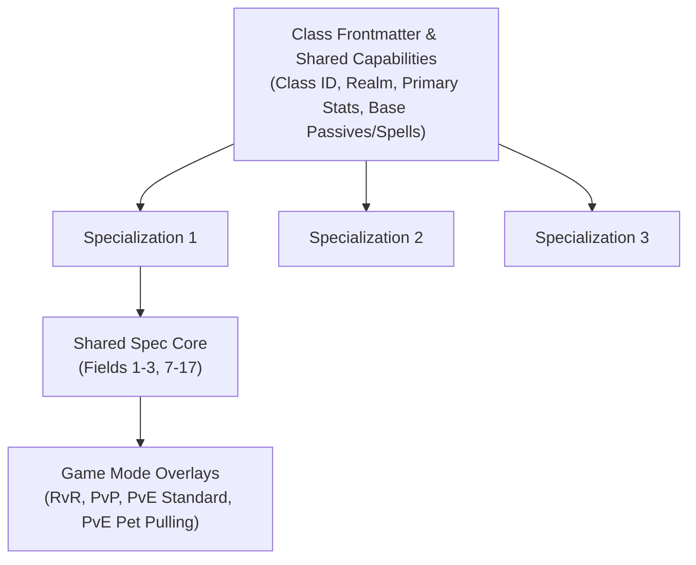

# Document 4: Class & Specialization Markdown Template Design (`CLASS_TEMPLATE_DESIGN.md`)

> [!IMPORTANT]
> **Design Objective:** Establish an extensible, human-editable Markdown definition format that allows the server owner to personally author class strategic intelligence incrementally across all 39 True 1.65 classes (3 specializations each = 117 total specs) without requiring any code changes to the SmartAI engine.

---

## 1. Storage Location, Versioning & Directory Architecture

### 1.1 File Placement & Build Pipeline Safety
- **Runtime Path**: `runtime/server/smartai/classes/<realm>/<class_name>.md`
- **Source Template Path**: `development-source/server/GameServer/smartai/specs/<realm>/<class_name>.md`

```
runtime/server/smartai/classes/
├── albion/
│   ├── armsman.md
│   ├── cleric.md
│   ├── friar.md
│   └── ... (14 total)
├── midgard/
│   ├── berserker.md
│   ├── healer.md
│   ├── shaman.md
│   └── ... (12 total)
└── hibernia/
    ├── animist.md
    ├── bard.md
    ├── druid.md
    └── ... (13 total)
```

**Two Critical Operational Safeguards Verified Against the Build Pipeline**:
1. **Placed Outside `runtime/true165/`**: `TrueMode.Refresh()` calculates a SHA-256 hash across `runtime/true165/*.json` ([`TrueMode.cs:72–110`](file:///C:/OfflineDAoC-True165-MP/OfflineDAoC-True165-MP/development-source/tools/OfflineDaoc.Launcher/TrueMode.cs#L72-L110)). If Markdown files were located in `runtime/true165/`, editing a class strategy would change the content hash, triggering a full database backup and transaction refresh! Placing them in `runtime/server/smartai/classes/` ensures Markdown changes never touch world database state.
2. **Never Use `.on` or `.off` File Extensions**: [`build_release_true165.py:56`](file:///C:/OfflineDAoC-True165-MP/OfflineDAoC-True165-MP/release-baselines/build_release_true165.py#L56) deletes all `*.on` and `*.off` files when packaging release baselines. Markdown files must always use standard `.md`.

### 1.2 Schema Versioning & Forward Compatibility
Every Markdown file begins with a standardized YAML-compliant frontmatter block including `schema_version: 1`. If the engine introduces new tactical primitives in future updates, `SmartAiSpecRegistry` inspects `schema_version` to provide backward-compatible defaults.

---

## 2. Dynamic Specialization Matching (Hired Companions vs. World Bots)

### 2.1 The Specialization Gap in DAoC Emulators
In DAoC, characters do not possess a formal "specialization subclass" field.
- **Autonomous World Bots**: Roll an `eSpecType` recorded in `BotLifetimeBuild` ([`BotLifetimeBuild.cs`](file:///C:/OfflineDAoC-True165-MP/OfflineDAoC-True165-MP/development-source/server/GameServer/bots/BotLifetimeBuild.cs)).
- **Hired Companions**: Start at level 5 with `SerializedSpecs = ""` and are manually trained and respecced by the human player via [`GameBot.CompanionTrain`](file:///C:/OfflineDAoC-True165-MP/OfflineDAoC-True165-MP/development-source/server/GameServer/bots/GameBot.cs#L3614-L3642) and [`GameBot.CompanionRespec`](file:///C:/OfflineDAoC-True165-MP/OfflineDAoC-True165-MP/development-source/server/GameServer/bots/GameBot.cs#L3635-L3642)!

### 2.2 Spec Matching Declaration (`match_specs`)
To support both seamlessly, each specialization block in the Markdown declares `match_specs` rules:
```yaml
match_specs:
  primary_line: "Rejuvenation"    # Spec line name in DAoC (Specs.Rejuvenation)
  min_point_ratio: 0.55           # Highest investment ratio or > 50% max points
  weapon_type: "Crushing"         # Optional weapon preference hint
  spec_type_aliases:              # For Autonomous Bots with pre-rolled eSpecType
    - "RejuvCleric"
```

**Resolution Algorithm (`SmartAiSpecRegistry.ResolveSpec`)**:
1. Check `offline_bot_smartai_profiles` for an explicit player override (`PreferredRole` or explicit spec name).
2. For Hired Companions (or any bot with trained spec points): scan the bot's live trained points via `bot.GetBaseSpecLevel(lineName)`. Identify the primary specialization line with the highest point investment. If the top line matches `primary_line`, select this specialization profile.
3. For Autonomous World Bots at low levels (levels 5–15 where spec points are tied): match `bot.BotSpec.SpecType.ToString()` against `spec_type_aliases`.
4. If no Markdown file exists for this class, or no specialization matches: **safely return `null`**, which triggers seamless per-bot fallback to legacy `BotBrain`!

---

## 3. Structural Information Architecture (All 17 Required Fields)

To prevent duplicating shared class mechanics across 3 specializations and multiple combat modes, the template uses a 3-tier hierarchy:



### Mapping of Specification Fields

| # | Field Name | Markdown Section | Purpose & SmartAI Engine Binding |
|---|---|---|---|
| **1** | Specialization Name | `## Specialization: <Name>` | Unique display and lookup key (e.g., `Rejuvenation Cleric`). |
| **2** | Intended Role | `role:` | `PrimaryHealer`, `MainTank`, `OffTankPeeler`, `CrowdControl`, `MeleeDps`, `CasterDps`, `StealthScout`, `HybridSupport`. |
| **3** | Combat Philosophy | `### Combat Philosophy` | Human-readable guiding doctrine for developers and debug inspection. |
| **4** | RvR Behavior | `#### Mode: RvR` | Battlefield priorities, keep-defense posture, warband coordination. |
| **5** | PvP Behavior | `#### Mode: PvP` | Small-scale duel/skirmish priorities, kiting, interrupt management. |
| **6a** | PvE Standard Behavior | `### 6a. Mode: PvE Standard` | Aggro management, add control, dungeon pacing, resting threshold. |
| **6b** | PvE Pet Pulling Behavior | `### 6b. Mode: PvE Pet Pulling` | Explicit pet pulling rules: mobs stay on pet for damage shield, tanks do not taunt, group stays put (no running for range), AoE begins at ~85% mob HP. |
| **6c** | PvE Solo Leveling & Dungeon Strategy | `### 6c. Mode: Solo Leveling & Dungeon Strategy` | Solo progression rules: Con targeting, rest pacing, dungeon corridor isolation, and caster outdoor prioritization (squishy casters stay outside due to tight space/interrupts, unless pet class or grouped). |
| **7** | Offensive Priorities | `### Offensive Priorities` | Ranked action candidate scores ($B_{\text{spec}}$) for nukes, styles, dots. |
| **8** | Defensive Priorities | `### Defensive Priorities` | Ranked candidate scores for self-shields, parry/evade buffs, potions, peels. |
| **9** | Target Priorities | `### Target Priorities` | Hostile scoring weights (Casters, Healers, Low HP, Tank Attacking Healer). |
| **10** | Positioning Preferences | `### Positioning Preferences` | Frontline, Midline, Backline, Flank/Rear arc, Preferred Range (units). |
| **11** | Ability Usage Priorities | `### Ability Usage Priorities` | Class abilities (`Engage`, `Berserk`) & RAs (`Purge`, `BoF`, `MoC`, `IP`). |
| **12** | Resource Management | `### Resource Management` | Mana/Endurance conservation thresholds, reserve floors, rest rules. |
| **13** | What the AI SHOULD Do | `### What the AI SHOULD Do` | Positive situational triggers boosting specific action weights. |
| **14** | What the AI MUST NOT Do | `### What the AI MUST NOT Do` | Hard rule gate prohibitions (breaks mez, overspends mana, shoots engaged). |
| **15** | Group Responsibilities | `### Group Responsibilities` | MA assist, off-heal, backup interrupt, backline guard/peel duties. |
| **16** | Situational Responses | `### Situational Responses` | Reactive rules (e.g., *On Stunned*, *On Outnumbered*, *On Healer OOM*). |
| **17** | Suggested Realm Abilities | `### Realm Ability Progression Order` | Ordered acquisition sequence for Old Frontiers RAs (Actives + Passives). |

### 3.1 Realm Ability Progression Order Integration
Field 17 establishes a structured priority list of Old Frontiers Realm Abilities (`AtlasOF_*`) tailored specifically to each specialization's role:
- **Autonomous World Bots**: Replaces the generic 4-archetype hardcoded lists in [`AutonomousBotRealmAbilities.cs`](file:///C:/OfflineDAoC-True165-MP/OfflineDAoC-True165-MP/development-source/server/GameServer/bots/autonomous/AutonomousBotRealmAbilities.cs#L57-L80), enabling world bots to build RAs customized for their exact build (e.g., a Smite Cleric purchases `MasteryOfMagery` and `WildPower` rather than pure healing passives).
- **Hired Companions**: Integrates directly with [`CompanionWindows165.cs`](file:///C:/OfflineDAoC-True165-MP/OfflineDAoC-True165-MP/development-source/server/GameServer/mode165/CompanionWindows165.cs) and `/companionui ra`. The server uses this progression to display recommended badges or auto-assign points for players who prefer automated companion management.
- **Combat Execution**: Feeds directly into Section 11 (`Ability Usage Priorities`) and Stage 3/5 of the decision engine (`SmartActionExecutor`), which executes active RAs (`Purge`, `MoC`, `BoF`, `MCL`, `TheEmptyMind`, etc.) when acquired.

### 3.2 PvE Pet Pulling Mode Architecture
Pet pulling is a specialized tactical PvE strategy in DAoC where a pet-caster class—**Spiritmaster** (Summoning), **Enchanter** (Mana), **Cabalist** (Matter), or **Necromancer** (Death Servant)—utilizes a summoned pet to draw enemy aggro from distant or dense camps and bring hostiles back to a stationary group anchor.

When the group coordinator detects an active pet pull (`GroupEngagementStatus == PetPulling`, triggered via `/say petpull`, voice command, or autonomous group pull coordinator):
1. **The Pet is the Primary Anchor Tank & Damage Shield Focus**:
   - **Mobs Stay on the Pet**: No tank or melee DPS should attempt to pull aggro or taunt the main pack off the pet. The strategy relies on keeping hostiles focused on the pet so that the pet caster's **Pulsing Damage Shield** inflicts continuous damage to all attacking monsters.
   - **Loose Mob Protection (Break-Off Protection)**: While the main pack stays on the pet, **tanks and other DPS can help attack mobs that break off from the pet** to protect squishy group members and maintain group safety.
2. **Smart Healing for the Pet (The 5% Mob Life Lost Threshold)**:
   - **Healers ARE Allowed to Heal the Pet**: Healers do not let the pet die unnecessarily. However, they must wait until the incoming mobs have lost around **5% of their life** (mobs at ~95% HP or below from damage shield contact ticks) before casting their first direct heal, ensuring the mobs have anchored threat on the pet.
   - **Smart Healing (Best Smallest Heal)**: Healers use "smart healing"—casting their **best smallest heal** (`HealEfficient` / minor baseline heal) to keep the pet topped off while minimizing healing aggro generation.
   - **Massive Damage Escalation**: If the pet is still taking massive damage (heavy multi-mob spike or rapid health drop), healers are authorized to escalate to a bigger heal (`HealBig`) to keep the pet alive.
   - *Allowed Pre-Cast Spells*: Pre-cast **Heal over Time (HoT)** spells from a Friar, Mentalist, Shaman, or Necromancer (cast *before* the pull) and the owner's **Pulsing Damage Shield** must always stay running on the pet.
3. **The 85% Mob Health AoE Trigger**:
   - **Cast Embargo Above ~85%**: While the main mob pack is above ~85% health, group members hold all area-of-effect spells. The damage shield does the work.
   - **AoE Unleashed at ~85%**: Once the mob pack reaches approximately **85% health** from damage shield ticks, classes equipped with Area of Effect (AoE) spells (PBAoE, targeted AoE) immediately begin casting on the cluster around the pet to melt the pack down rapidly.
4. **Group Stays Put (Strict Positioning Discipline)**:
   - **Never Run Away for Range**: Group members must **stay put** at the camp anchor. Bots do **NOT** flee or kite backwards to achieve maximum casting or archery range.
   - **Puller Responsibility**: The pet puller is 100% responsible for bringing the mobs directly into the parked group so all members can execute their roles from their established positions.
5. **Pet Management DOs and DON'Ts**:
   - **DO**: Set pet to **Passive** before initiating the pull; recall immediately via `/pet return` / `/pet follow` upon body/proximity contact.
   - **DO**: Pre-buff the pet with defensive stat buffs (AF, Dex/Quickness) so it survives multiple hits.
   - **DON'T**: Attack with the pet unless necessary (proximity body pulling is preferred).
   - **DON'T**: Heal the pet before mobs lose ~5% life.
   - **DON'T**: Path the pet through uncleared camps.
   - **DON'T**: Forget to break pet `Guard` mode before pulling.

### 3.3 PvE Solo Leveling & Dungeon Strategy Architecture
Field 6c (`### 6c. Mode: Solo Leveling & Dungeon Strategy`) provides deterministic behavioral directives for autonomous world bots and hired companions when roaming, leveling, or executing solo grinding sessions without a full balanced group:

1. **Target Consideration & Con Color Thresholds**:
   - **Primary Targets (Blue & High Blue)**: Optimal XP-to-downtime ratio. Minimal miss rate, negligible spell resist rate, low resource consumption.
   - **Secondary Targets (Yellow)**: Standard 1-on-1 solo baseline. Requires full mana/endurance before initiating. Yields standard single-mob XP without risk of death.
   - **Restricted Targets (Orange)**: Engage only if character has offensive/defensive cooldowns available (`QuickCast`, `Purge`, `Berserk`, `IP`, active spec buffs) and full health/mana/endurance.
   - **Prohibited Targets (Red & Purple)**: **Strictly forbidden** for solo engagement across all classes. High miss/resist rate guarantees death or resource exhaustion.

2. **Downtime Management & Rest Protocol**:
   - After combat disengagement, if **Health < 50%**, **Mana < 20%**, or **Endurance < 20%**, transition immediately to `RestingState` (Sit/Crouch).
   - Autonomous bots must scan a 1000-unit perimeter for roaming hostiles before sitting. If a patrol is within aggro range, reposition 500 units away into cleared space before resting.
   - Do not break rest until Health >= 90% and Mana/Endurance >= 85%.

3. **Caster Outdoor Leveling Policy vs. Dungeon Embargo**:
   - **Pure Squishy Casters** (**Wizard, Sorcerer, Eldritch, Runemaster, Mentalist**):
     - **Severe Dungeon Bottleneck Vulnerability**: Dungeon corridors have tight walls, short sightlines (<800 units), low ceilings, and dense patrol paths. Because any physical hit causes a 100% spell interrupt (unless `QuickCast` is active), pure cloth casters cannot maintain safe casting distances or kite mobs effectively in dungeons.
     - **Outdoor World Leveling Priority**: Pure casters **must prioritize open-world leveling** across outdoor zones (Salisbury Plains, Black Mountains, Dartmoor, Gotar, Raumarik, Shannon Estuary, Connacht, etc.). Open zones afford 1500–2000 unit kiting lanes, reliable root/snare spacing, and long-range pre-casts.
     - **Dungeon Solo Embargo**: Pure casters are **prohibited from soloing inside dungeons** (Tomb of Mithra, Catacombs, Spindelhalla, Coruscating Mine, Tepok's Mine, Treibh Caillte) unless they join a group containing at least one designated tank and healer.
   - **Pet Caster Dungeon Exception** (**Cabalist, Necromancer, Enchanter, Spiritmaster, Bonedancer, Animist**):
     - **Exempt from Dungeon Embargo**: Pet-wielding casters are explicitly permitted to solo in dungeons!
     - **Corridor Door-Blocking & Threat Anchoring**: The summoned pet acts as a mobile obstacle and aggro sponge. The caster parks the pet at corridor chokepoints or room doorways (`/pet stay` / `/pet guard`), commands the pet to engage the incoming mob, and stands safely 500–800 units behind the pet in line-of-sight to cast nukes, debuffs, or lifetaps with zero risk of melee interrupt.

4. **Melee Heavy Tanks & Flankers Dungeon Pacing**:
   - **Heavy Tanks** (**Paladin, Armsman, Warrior, Thane, Hero**):
     - High plate/chain armor, shields, and parry make melee tanks highly effective in dungeons.
     - **Corridor Pull Isolation**: Never charge into an uncleared room. Use ranged weapons (Crossbow, Longbow, Throwing Axe, Spear) or body-pulling to isolate single mobs back into previously cleared corridors to prevent wandering patrol adds.
   - **Melee Flankers & Dual-Wield Strikers** (**Mercenary, Berserker, Savage, Blademaster, Champion, Valewalker, Reaver**):
     - Use stun openers and positional flank/rear combos. Pull targets to corridor turns to prevent ranged caster/archer adds from getting line of sight on the bot.

5. **Stealthers & Archers Strategy**:
   - **Archers** (**Scout, Hunter, Ranger**): Prioritize outdoor world leveling for maximum 2000-unit bow shots and root/kite rotations. In dungeons, use stealth to bypass link packs and single-pull with bow from maximum corridor distance.
   - **Stealth Assassins** (**Infiltrator, Shadowblade, Nightshade**): Navigate past linked or dangerous packs using stealth. Open with positional stealth stuns (`Perforate Artery`, `Backstab`, `Garrote`) on isolated Blue/Yellow mobs, applying envenomed debuffs and finishing with fast style chains.

6. **Primary Healers, Buffers & Hybrids**:
   - **Support Casters** (**Cleric, Shaman, Druid, Healer**): Solo leveling is viable using self-buffs and spec direct damage / smite / root-kiting against Blue/Yellow mobs. In dungeons, pull with root/smite to room entryways and maintain self-heals; sit immediately after each single kill.
   - **Hybrids & Pet Charmers** (**Friar, Minstrel, Bard, Warden, Skald**):
     - Minstrels and Bards use **Charm** on local dungeon monsters, converting them into powerful disposable pets that absorb all dungeon aggro.
     - Friars and Wardens utilize high melee defense, self-buffs, and self-regeneration to continuously grind single mobs in dungeons with minimal downtime.

---

## 4. Illustrative Structural Skeleton (Example: Cleric)

> [!NOTE]
> This skeleton demonstrates the exact Markdown structure covering all 16 fields for one class. Final templates for all 39 classes will be authored in future phases.

```markdown
---
schema_version: 1
class_name: "Cleric"
class_id: 6
realm: "Albion"
primary_stats: ["Piety", "Constitution"]
default_personality: "Supportive"
---

# Class: Cleric

## Shared Class Capabilities
- Base armor: Chain
- Primary weapon: Crushing (One-Handed) + Shield
- Core spell lines: Rejuvenation, Enhancement, Smite

---

## Specialization: Rejuvenation Cleric
- **role**: PrimaryHealer
- **default_personality**: Supportive

```yaml
match_specs:
  primary_line: "Rejuvenation"
  min_point_ratio: 0.50
  spec_type_aliases: ["RejuvCleric"]
```

### 1. Intended Role & 3. Combat Philosophy
The Rejuvenation Cleric is the primary lifeline of the group. Its sole imperative is keeping allies alive through efficient triage, preemptive buffering, and emergency intervention. Direct damage is forbidden unless the entire group is completely stabilized and a finishable enemy is called.

### 7. Offensive Priorities
1. Direct Damage (Smite): Priority 10 (Only if all group members > 90% HP and mana > 50%)
2. Melee Attack: Priority 0 (Disabled)

### 8. Defensive Priorities
1. Self-Cast Bubble / Absorb Buff: Priority 90
2. Cast Concentration Buffs on Group (Base AF, Str/Con, Dex/Qui): Priority 85 (Out of Combat)
3. Self-Purge on CC: Priority 95 (If group members taking damage while Cleric is stunned/mezzed)

### 9. Target Priorities
1. Primary Heal Target: Lowest effective HP% group member (weighted by incoming attackers)
2. Cure Target: Group members afflicted with Mez or Disease (halving healing)
3. Offensive Target: Main Assist Target (only during execute phase)

### 10. Positioning Preferences
- **Anchor**: Backline
- **Distance**: 1200 - 1450 units behind Frontline
- **LOS Discipline**: Maintain continuous line of sight to group anchor; break LOS to enemy archers/casters behind terrain between casts.

### 11. Ability Usage Priorities
1. QuickCast: Priority 95 (Use when interrupted and a group member is < 30% HP)
2. Mastery of Concentration: Priority 90 (Use during heavy melee train focus)
3. Purge: Priority 85 (Use when crowd-controlled during active combat)

### 12. Resource Management
- **Conservative Mana Floor**: 30% (Reserve for emergency heals and rez)
- **Spell Selection Thresholds**:
  - Target HP 65% - 85%: `HealEfficient` (Greater Heal)
  - Target HP 30% - 65%: `HealBig` (Major Heal)
  - Target HP < 30%: `HealInstant` + `HealBig`
  - 3+ members < 70%: `HealSpread` / `HealGroup`

### 13. What the AI SHOULD Do
- Pre-cast heals on tanks initiating large pulls or absorbing focus fire.
- Prioritize curing Disease immediately before casting major heals.
- Call out heavy incoming damage and low mana in group chat.

### 14. What the AI MUST NOT Do
- MUST NOT engage in melee combat under any circumstances.
- MUST NOT cast offensive Smite spells while any group member is < 85% HP.
- MUST NOT break crowd-controlled (mezzed) enemies with area-of-effect spells.
- MUST NOT sit to rest while any group member has active aggro within 2000 units.

### 15. Group Responsibilities
- Main Healer: Primary triage ownership for all 8 group members.
- Cure coordinator: Rapid removal of Mez (`CureMezz`) and Disease (`CureDisease`).
- Emergency Alert: Enqueue `HeavyGroupDamageWarning` to group coordinator when HPS deficit exceeds 40%.

### 16. Situational Responses
- **When Attacked by Enemy Melee**:
  - Trigger `HealerUnderAttack` observation to prompt tank/peeler peel.
  - Cast instant stun/root or run through friendly frontline to bring pursuers into assist train.
- **When Silenced or OOM**:
  - Fall back behind cover immediately; pop Mana Potion or `MysticCrystalLore`.

### 4. Mode: RvR
- Target priority shift: Highest priority on curing Mez/Root on friendly Main Assist and off-tanks.
- Spread position: Maximize distance from other casters to avoid clustered enemy PBAoE or AoE Mez.
- Cooldown usage: Aggressive use of `Purge` and `MoC` on first engagement.

### 5. Mode: PvP
- Kiting: Utilize pillar/tree obstacles to break enemy archer/caster lines of sight.
- Counter-interrupt: Bait enemy melee into swing recovery before starting major cast.

### 6. Mode: PvE
- Aggro management: Avoid casting instant group heals on pull before tank establishes taunt.
- Mana conservation: Prioritize resting between pulls; alert group to hold pulls if mana < 35%.

---

## Specialization: Enhancement Cleric
*(Follows the exact same 16-field structure, focused on Buffing, Off-Healing, and Smite assistance)*

---

## Specialization: Smite Cleric
*(Follows the exact same 16-field structure, focused on Caster DPS, Stun peel, and Backup Healing)*
```

---

## 5. Parser, Validator & Hot-Reload Engine

### 5.1 Zero-Dependency Markdown Parser (`SmartAiMarkdownParser.cs`)
To keep the server lightweight and eliminate external NuGet dependencies, the parser uses a deterministic streaming line reader:
- Parses YAML frontmatter between `---` fences.
- Detects `## Specialization: <Name>` as primary specialization boundaries.
- Extracts ````yaml match_specs ... ```` blocks for binding metadata.
- Reads `### <Heading>` blocks into a strongly typed `SmartSpecDefinition` dictionary.
- Compiles priority lists (e.g. `1. Smite: Priority 80`) into static numeric lookup tables.

### 5.2 Schema Validator (`SmartAiSpecValidator.cs`)
Invoked at server startup:
- Validates that all referenced spell lines, style names, abilities, and RAs actually exist in the game database via `SkillBase`.
- Confirms all 16 required sections are present.
- Detects conflicting rules (e.g., an offensive priority referencing a disabled spell line).
- Logs clear errors with line numbers to `DOL.Logging`:
  `[ERROR] SmartAI Spec Validator: albion/cleric.md (Line 42): Unknown spell line 'FakeSpells'!`

### 5.3 Live Hot-Reloading (`/smartai reload`)
A GM command `/smartai reload` re-parses all Markdown files in `runtime/server/smartai/classes/`:
1. Parses and validates all files into a temporary staging registry.
2. If validation succeeds: atomically swaps the active pointer (`Interlocked.Exchange(ref _activeRegistry, stagingRegistry)`).
3. If validation fails: leaves the existing registry untouched and prints error details to the GM player in game chat! Zero server downtime.
