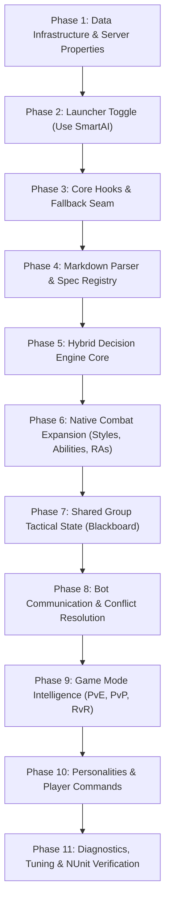

# Document 5: Claude Code Implementation Blueprint (`CLAUDE_CODE_IMPLEMENTATION_PLAN.md`)

> [!IMPORTANT]
> **Developer Handoff Target:** This document is the primary technical execution manual for **Claude Code**. Every phase contains exact file paths, method anchors, newly created files, data structures, test criteria, and explicit risk assessments.

---

## 1. Technical Baseline & Directory Structure

- **Solution**: `development-source/server/Dawn of Light.sln` (.NET 10, C# 13, x64).
- **Launcher Project**: `development-source/tools/OfflineDaoc.Launcher/OfflineDaoc.Launcher.csproj`.
- **Target Runtime Output**:
  - Whenever `GameServer.dll` is compiled, rule #11 requires deploying to three destinations: `runtime/server/GameServer.dll`, `runtime/server/lib/GameServer.dll`, and `runtime/server/win-x64/GameServer.dll` (with backup).
- **SmartAI Source Folder**: All new engine code belongs strictly in:
  `development-source/server/GameServer/smartai/` (`namespace DOL.GS.SmartAI`)

```
development-source/server/GameServer/smartai/
├── config/
│   ├── SmartAiProperties.cs
│   └── SmartAiConfig.cs
├── core/
│   ├── SmartAiBrainDriver.cs
│   └── SmartAiCoordinator.cs
├── decision/
│   ├── SmartBotPerception.cs
│   ├── SmartRuleGateEvaluator.cs
│   ├── SmartCandidateGenerator.cs
│   ├── SmartUtilityScorer.cs
│   └── SmartActionExecutor.cs
├── communication/
│   ├── SmartGroupTacticalState.cs
│   ├── SmartGroupTacticalSnapshot.cs
│   ├── SmartBotObservation.cs
│   ├── SmartGroupCoordinator.cs
│   └── SmartGroupCalloutPolicy.cs
├── specs/
│   ├── SmartSpecDefinition.cs
│   ├── SmartAiMarkdownParser.cs
│   ├── SmartAiSpecValidator.cs
│   └── SmartAiSpecRegistry.cs
├── personalities/
│   ├── SmartPersonalityProfile.cs
│   └── SmartPersonalityRegistry.cs
├── persistence/
│   └── OfflineBotSmartAiProfileRecord.cs
├── diagnostics/
│   ├── SmartAiDiagnostics.cs
│   └── SmartAiCommand.cs
└── styles/
    └── SmartStyleSelector.cs
```

---

## 2. Phased Implementation Sequence



---

### Phase 1: Data Infrastructure & Server Properties
- **Objective**: Establish persistent configuration properties and the bot personality side-table in DOL without touching core AI behavior.
- **Files Involved**:
  - **NEW**: `GameServer/smartai/config/SmartAiProperties.cs`
  - **NEW**: `GameServer/smartai/persistence/OfflineBotSmartAiProfileRecord.cs`
  - **MODIFIED**: `GameServer/GameServer.cs` (`InitDB()`, lines 1187–1232; auto-registers via reflection, verify no exceptions).
- **Key Data Structures**:
  - `OfflineBotSmartAiProfileRecord` decorated with `[DataTable(TableName = "offline_bot_smartai_profiles")]` (`BotId`, `Personality`, `PreferredRole`, `UpdatedUtc`).
  - `SmartAiProperties.USE_SMART_AI` (`[ServerProperty("autonomous", "use_smart_ai", ..., false)]`).
- **Dependencies**: None.
- **Expected Results**: Table auto-creates in SQLite on server boot; `ServerProperty` row `use_smart_ai` defaults to `'False'`.
- **Testing Requirements**: Run `GameServer.exe` once; query SQLite to verify table exists and clean up does not purge `use_smart_ai`.
- **Completion Criteria**: Clean startup with zero log errors.
- **Risks**: Running `Properties.CleanUpDatabase()` before property registration could purge row; avoided by registering in `SmartAiProperties`.

---

### Phase 2: Launcher Toggle Integration (`Use SmartAI`)
- **Objective**: Implement the persistent `Use SmartAI` checkbox in `OfflineDAoC.exe` matching user requirements.
- **Files Involved**:
  - **MODIFIED**: `development-source/tools/OfflineDaoc.Launcher/MainForm.cs`
    - Lines 165–175: declare `private CheckBox _useSmartAi;`
    - Lines 525–585 (`BuildOptionsPanel`): add checkbox to `optionsLayout` and expand panel height to 370.
    - Lines 1560–1590: implement `PersistSmartAiSetting(bool enabled)`.
    - Lines 1740–1773: implement `ReadOptInSwitch()` and update `ReadSnapshot()`.
    - Lines 1820–1850: update `UpdateUiFromSnapshot()`.
- **Key Data Structures**: Launcher UI controls only.
- **Dependencies**: Phase 1.
- **Expected Results**:
  - Toggling checkbox while server is stopped writes `'True'`/`'False'` to `ServerProperty`.
  - Checkbox is disabled while server is running.
  - Setting persists across launcher restarts.
- **Testing Requirements**: Unit test in `Tests/UnitTests/SmartAI/UT_LauncherSmartAiConfig.cs` verifying UI state and SQLite queries.
- **Completion Criteria**: Setting survives launcher reboots and defaults to unchecked on clean DB.
- **Risks**: Accidentally using `ReadSwitch` (which defaults missing rows to true). Mitigated by mandatory `ReadOptInSwitch`.

---

### Phase 3: Core AI Hook Points & Dual-Tier Fallback Seam
- **Objective**: Create the non-invasive interception points in `NpcService.Tick()` and `BotBrain.Think()` with instant bypass when disabled.
- **Files Involved**:
  - **NEW**: `GameServer/smartai/config/SmartAiConfig.cs`
  - **NEW**: `GameServer/smartai/core/SmartAiCoordinator.cs`
  - **NEW**: `GameServer/smartai/core/SmartAiBrainDriver.cs`
  - **MODIFIED**: `GameServer/ECS-Services/NpcService.cs` (lines 28–33: add `if (SmartAiConfig.IsEnabled) SmartAiCoordinator.PrepareTick();`).
  - **MODIFIED**: `GameServer/bots/BotBrain.cs` (lines 3266–3284 in `BotState_Aggro.Think()`: insert `if (SmartAiBrainDriver.TryThinkCombat(this)) return;`).
- **Key Data Structures**:
  - `SmartAiConfig.IsEnabled` boolean check.
- **Dependencies**: Phase 1, 2.
- **Expected Results**: When toggle is OFF, zero new code executes during combat. When ON, calls dispatch into `SmartAiBrainDriver`.
- **Testing Requirements**: In-game combat test with toggle OFF to prove 100% legacy parity.
- **Completion Criteria**: Server runs with toggle ON/OFF with zero regression.
- **Risks**: Accidental uncaught exception in `SmartAiBrainDriver` could crash worker thread; mitigated by `try/catch` wrapping that triggers per-bot fallback.

---

### Phase 4: Markdown Class Loader, Validator & Registry
- **Objective**: Load and validate Markdown class/spec definitions from disk with hot-reloading support.
- **Files Involved**:
  - **NEW**: `GameServer/smartai/specs/SmartSpecDefinition.cs`
  - **NEW**: `GameServer/smartai/specs/SmartAiMarkdownParser.cs`
  - **NEW**: `GameServer/smartai/specs/SmartAiSpecValidator.cs`
  - **NEW**: `GameServer/smartai/specs/SmartAiSpecRegistry.cs`
  - **NEW**: `GameServer/smartai/diagnostics/SmartAiCommand.cs` (`/smartai reload`)
  - **NEW**: `runtime/server/smartai/classes/albion/cleric.md` (initial test definition)
- **Key Data Structures**:
  - `FrozenDictionary<(int ClassId, string SpecName), SmartSpecDefinition>`
- **Dependencies**: Phase 3.
- **Expected Results**:
  - Parses Markdown files at server startup.
  - Resolves Hired Companions via trained spec points and Autonomous Bots via `SpecType`.
  - Missing class Markdown safely returns `null` (triggering legacy fallback for that bot).
  - `/smartai reload` updates templates live without restart.
- **Testing Requirements**: NUnit test parsing valid and corrupt Markdown files; verify graceful failure reporting.
- **Completion Criteria**: `cleric.md` loads with 0 errors; missing classes fall back safely.
- **Risks**: Malformed Markdown crashing startup; mitigated by validator catching syntax errors before activating registry.

---

### Phase 5: Hybrid Decision Engine Core
- **Objective**: Implement the 5-stage decision engine (Perception -> Rule Gates -> Candidates -> Utility -> Execution).
- **Files Involved**:
  - **NEW**: `GameServer/smartai/decision/SmartBotPerception.cs`
  - **NEW**: `GameServer/smartai/decision/SmartRuleGateEvaluator.cs`
  - **NEW**: `GameServer/smartai/decision/SmartCandidateGenerator.cs`
  - **NEW**: `GameServer/smartai/decision/SmartUtilityScorer.cs`
  - **NEW**: `GameServer/smartai/decision/SmartActionExecutor.cs`
- **Key Data Structures**:
  - `readonly ref struct SmartBotPerception`
  - `Span<SmartActionCandidate>` (stack allocated, zero GC)
- **Dependencies**: Phase 4.
- **Expected Results**: Bots execute specialization-driven combat rules; respects mez and hard prohibitions.
- **Testing Requirements**: Unit tests simulating combat states; verify rule gates take precedence over utility scores.
- **Completion Criteria**: Test Cleric accurately heals damaged allies and refrains from breaking mez.
- **Risks**: High GC allocation per tick; mitigated by using stackalloc and ref structs.

---

### Phase 6: Native Combat Expansion (Styles, Abilities & RAs)
- **Objective**: Unlock positional melee styles, stealth openers, `QuickCast`, and active RAs for Hired Companions.
- **Files Involved**:
  - **NEW**: `GameServer/smartai/styles/SmartStyleSelector.cs`
  - **MODIFIED**: `GameServer/bots/GameBot.cs`
    - Add `allowQuickCast` parameter to `CastSpell(..., bool allowQuickCast = false)`.
    - Support positional style validation via `StyleProcessor.CanUseStyle`.
  - **MODIFIED**: `GameServer/bots/autonomous/AutonomousBotRealmAbilities.cs` (or extend in `SmartActionExecutor` to support Hired Companion RAs from `OfflineHiredCompanionRecord.RealmAbilities`).
- **Key Data Structures**:
  - Positional angle checks (`150°–210°` back, `45°–150°` side).
- **Dependencies**: Phase 5.
- **Expected Results**: Melee bots execute flank/back styles when target is engaged with another player/tank; healers utilize `QuickCast` and `MoC`.
- **Testing Requirements**: In-game duel/combat with Infiltrator/Mercenary to verify positional style execution.
- **Completion Criteria**: Positional styles fire reliably in combat.
- **Risks**: Breaking legacy `CastSpell` callers; mitigated by keeping default `allowQuickCast = false`.

---

### Phase 7: Shared Group Tactical State (Blackboard)
- **Objective**: Implement the thread-safe group blackboard publishing immutable snapshots every tick.
- **Files Involved**:
  - **NEW**: `GameServer/smartai/communication/SmartGroupTacticalState.cs`
  - **NEW**: `GameServer/smartai/communication/SmartGroupTacticalSnapshot.cs`
  - **MODIFIED**: `GameServer/smartai/core/SmartAiCoordinator.cs`
- **Key Data Structures**:
  - `ConditionalWeakTable<Group, SmartGroupTacticalState>`
  - `SmartGroupTacticalSnapshot` (double-buffered, published in `PrepareTick()`).
- **Dependencies**: Phase 5, 6.
- **Expected Results**: All bots in a group read a consistent view of Main Assist, Primary Target, CC claims, and heal priorities.
- **Testing Requirements**: Concurrency test simulating 8 threads reading snapshot while single thread publishes update.
- **Completion Criteria**: Zero data races or torn reads across parallel `Think()` pulses.
- **Risks**: Contention on locks; mitigated by single-threaded pre-pass publishing immutable snapshots.

---

### Phase 8: Bot Communication & Conflict Resolution
- **Objective**: Enable bots to post structured tactical observations and arbitrate conflicting suggestions.
- **Files Involved**:
  - **NEW**: `GameServer/smartai/communication/SmartBotObservation.cs`
  - **NEW**: `GameServer/smartai/communication/SmartGroupCoordinator.cs`
  - **NEW**: `GameServer/smartai/communication/SmartGroupCalloutPolicy.cs`
- **Key Data Structures**:
  - Ring buffer of `SmartBotObservation` (`Capacity = 32`).
- **Dependencies**: Phase 7.
- **Expected Results**: Tanks propose target switches; healers warn of high damage; human leader maintains final authority; optional `/g` callouts emitted max once per 8s.
- **Testing Requirements**: Simulation tests with competing suggestions; verify authority hierarchy resolves deterministically.
- **Completion Criteria**: Verified resolution order (Human > Leader > Urgency).
- **Risks**: Chat spam in `/g`; mitigated by strict `SmartGroupCalloutPolicy` throttling.

---

### Phase 9: Game Mode Intelligence (PvE, PvP, RvR)
- **Objective**: Implement mode detection and dynamic behavior shifts without duplicating class intelligence.
- **Files Involved**:
  - **NEW**: `GameServer/smartai/core/SmartGameMode.cs`
  - **MODIFIED**: `GameServer/smartai/decision/SmartBotPerception.cs` (detect mode: `RvR`, `PvP`, `PvE`).
  - **MODIFIED**: `GameServer/smartai/decision/SmartUtilityScorer.cs` (apply mode deltas).
- **Key Data Structures**:
  - `enum SmartGameMode { PvE, PvP, RvR }`
- **Dependencies**: Phase 5, 8.
- **Expected Results**: In RvR, bots prioritize enemy healers/CC and spread out; in PvE, bots prioritize threat holding and add parking.
- **Testing Requirements**: Combat scenarios in frontier vs. dungeon vs. duel.
- **Completion Criteria**: Bot behaviors visibly adapt according to active zone and target realm.
- **Risks**: Misclassifying target mode; mitigated by checking `PlayerRules165.IsPlayerLike(target)`.

---

### Phase 10: Personalities & Player Commands
- **Objective**: Implement the 6 personality profiles and player configuration commands.
- **Files Involved**:
  - **NEW**: `GameServer/smartai/personalities/SmartPersonalityProfile.cs`
  - **NEW**: `GameServer/smartai/personalities/SmartPersonalityRegistry.cs`
  - **MODIFIED**: `GameServer/mode165/CompanionChat165.cs` (add voice hooks: e.g. `"Cedric personality aggressive"`).
  - **MODIFIED**: `GameServer/smartai/diagnostics/SmartAiCommand.cs` (`/smartai personality`).
- **Key Data Structures**:
  - Multipliers for `Aggressive`, `Defensive`, `Tactical`, `Opportunistic`, `Supportive`, `Conservative`.
- **Dependencies**: Phase 1, 5, 8.
- **Expected Results**: Players can customize companion personalities; adjustments alter tactical weights without breaking hard rules.
- **Testing Requirements**: Compare action selection of Aggressive vs. Defensive profiles in identical combat states.
- **Completion Criteria**: Distinct, observable tactical preferences between profiles.
- **Risks**: Overly extreme personality multipliers destabilizing combat; mitigated by bounding multipliers between `0.80x` and `1.25x`.

---

### Phase 11: Diagnostics, Anti-Oscillation Tuning & NUnit Test Suite
- **Objective**: Add ring-buffer telemetry, tune target-stickiness hysteresis, and verify performance under load.
- **Files Involved**:
  - **NEW**: `GameServer/smartai/diagnostics/SmartAiDiagnostics.cs`
  - **NEW**: `Tests/UnitTests/SmartAI/UT_SmartAiDecisionEngine.cs`
  - **NEW**: `Tests/UnitTests/SmartAI/UT_SmartAiGroupCoordination.cs`
  - **NEW**: `Tests/UnitTests/SmartAI/UT_SmartAiPerformance.cs`
- **Key Data Structures**:
  - Ring buffer of last 32 decisions per bot for `/smartai debug <bot>`.
- **Dependencies**: Phases 1–10.
- **Expected Results**:
  - Zero target jitter/oscillation during combat.
  - Average `Think()` execution time `< 0.05 ms` per bot.
  - Zero performance regression reported in `bot-ai-delay.json`.
- **Testing Requirements**: Full execution of NUnit test suites.
- **Completion Criteria**: All tests pass; `BotAiDelayReport` shows zero degradation.
- **Risks**: Diagnostic logging causing disk lag; mitigated by keeping in-memory ring buffers and disabling trace logging by default.
