# Document 1: OfflineDAoC True 1.65 — Project & AI Architecture Analysis (`PROJECT_ANALYSIS.md`)

> [!IMPORTANT]
> **Verification Standard:** Every class, method, table, protocol command, and line range in this document was verified directly against the repository at `C:\OfflineDAoC-True165-MP\OfflineDAoC-True165-MP`. No source code, configuration files, databases, or launcher files were modified during this investigation.

---

## 1. Executive Summary & System Context

**Offline DAoC True 1.65** (`v0.2`) is a self-contained single-player Dark Age of Camelot Classic + Shrouded Isles (patch **1.65**, 1 November 2003) world built on four tightly integrated components ([AGENTS.md](file:///C:/OfflineDAoC-True165-MP/OfflineDAoC-True165-MP/AGENTS.md#L7-L61)):

1. **Game Server (`development-source/server/`)**: An OpenDAoC / Dawn of Light fork targeting **C# / .NET 10** (`Dawn of Light.sln`) backed by **SQLite** (`runtime/data/opendaoc-165.sqlite3.db`) and an Entity-Component-System (**ECS**) 30 TPS game loop ([GameLoop.cs](file:///C:/OfflineDAoC-True165-MP/OfflineDAoC-True165-MP/development-source/server/GameServer/Managers/GameLoop/GameLoop.cs#L27-L173)).
2. **True 1.65 Mode Layer (`GameServer/mode165/`)**: Enforced globally via [`Classic165Mode.IsOn`](file:///C:/OfflineDAoC-True165-MP/OfflineDAoC-True165-MP/development-source/server/GameServer/mode165/Classic165Mode.cs#L15-L21) (`ServerProperty` `"classic165_mode" = "True"`). Provides persistent player-owned **Hired Companions**, inn recruitment/vault/training UI protocols, period 1.65 combat/charm/XP/crafting rules, and [`PlayerRules165.IsPlayerLike`](file:///C:/OfflineDAoC-True165-MP/OfflineDAoC-True165-MP/development-source/server/GameServer/mode165/PlayerRules165.cs#L10-L20) parity so bots obey player rules rather than monster shortcuts.
3. **Autonomous Population & Tactical Bot Layer (`GameServer/bots/` & `GameServer/bots/autonomous/`)**: Populates all three realms (`Albion`, `Midgard`, `Hibernia`) with persistent `GameBot` characters stored in `offline_world_bots` that level from 1 to 50, promote from base classes at level 5, form PvE camp groups, run dungeons/raids, contest Battlegrounds, siege Old Frontiers keeps, and run Relic Raids.
4. **Launcher (`development-source/tools/OfflineDaoc.Launcher/`) & Godot 4 Client (`source/new-client/`)**: `OfflineDAoC.exe` ([MainForm.cs](file:///C:/OfflineDAoC-True165-MP/OfflineDAoC-True165-MP/development-source/tools/OfflineDaoc.Launcher/MainForm.cs)) manages the SQLite database, applies `runtime/true165/*.json` content refreshes, configures server/bot options, and launches `CoreServer.exe` and the Godot 4 client.

### Core Architectural Insight for SmartAI
All bot archetypes in the server—**Hired Companions**, **Player-Invited World Bots**, **Autonomous World Bots**, and **GM `/spawn` or `/raid` Helpers**—instantiate the exact same entity class ([`GameBot`](file:///C:/OfflineDAoC-True165-MP/OfflineDAoC-True165-MP/development-source/server/GameServer/bots/GameBot.cs#L32)) and brain class ([`BotBrain`](file:///C:/OfflineDAoC-True165-MP/OfflineDAoC-True165-MP/development-source/server/GameServer/bots/BotBrain.cs#L24)) (the lone exception, [`SluaghbinderBotBrain`](file:///C:/OfflineDAoC-True165-MP/OfflineDAoC-True165-MP/development-source/server/GameServer/bots/SluaghbinderBotBrain.cs#L15), belongs to a custom class disabled in True 1.65). Furthermore, even Autonomous World Bots **yield 100% of active combat execution back to `BotBrain`** inside [`AutonomousWorldBotController.Tick`](file:///C:/OfflineDAoC-True165-MP/OfflineDAoC-True165-MP/development-source/server/GameServer/bots/autonomous/AutonomousWorldBotController.cs#L421-L448). This gives SmartAI a single, clean, non-destructive interception seam.

---

## 2. Inventory of Inspected vs. Uninspected Areas

Per Section 1 of the research specification, the following inventory records what was directly inspected versus intentionally left out of scope:

| Area / Subsystem | Status | Files & Scope Verified |
|---|---|---|
| Top-level & Developer Docs | **Inspected (100%)** | `AGENTS.md`, `CLAUDE.md`, `DEVELOPMENT - START HERE.md`, `README.md`, `CHANGELOG.md`, `QUICK COMMANDS.txt`, `docs/DEVELOPMENT.md`, `docs/LLM-QUICKSTART.md`, `docs/PLAY.md`, `development-source/server/AGENTS.md`, `BotsUML.md` |
| True 1.65 Mode & Hired Companions | **Inspected (100%)** | All files in `GameServer/mode165/` (`Classic165Mode.cs`, `PlayerRules165.cs`, `HiredCompanions165.cs`, `Hire165.cs`, `CompanionWindows165.cs`, `CompanionGearVault165.cs`, `CompanionChat165.cs`, `BaseClassBots165.cs`, `Inn165.cs`, `Horn165.cs`, etc.) + `CompanionUiCommand.cs` + `TRUE 1.65 MODE HIRE WINDOW PROTOCOL.md` |
| `GameBot` & `BotBrain` Core AI | **Inspected (100%)** | `GameBot.cs` (5,638 lines), `IGamePlayer.cs`, `BotBrain.cs` (5,792 lines) + all 8 `BotBrain.*.cs` partial files + all 20 companion/combat policy classes (`BotMeleeStylePolicy.cs`, `BotCastInterruptPolicy.cs`, `BotInterruptTargetSelector.cs`, `BotCurePrioritizer.cs`, `BotDefensiveAbilityPolicy.cs`, `BotGroupBuffCoordinator.cs`, `PlayerLedPullCoordinator.cs`, `CompanionEngagementMode.cs`, `CompanionFollowPolicy.cs`, `CompanionStealth.cs`, `SavageBotCombatPolicy.cs`, `BotManager.cs`, `BotDatabase.cs`, `BotCommand.cs`, etc.) |
| Autonomous Population, Group & RvR AI | **Inspected (100%)** | `AutonomousWorldBotController.cs` + 8 partials, `AutonomousBotDecisionEngine.cs`, `AutonomousAiBudget.cs`, `AutonomousFidelityPolicy.cs`, `AutonomousBotRegistry.cs`, `AutonomousPopulationController.cs`, `AutonomousBotGroupCoordinator.cs` + partials, `AutonomousGroupCombatDoctrine.cs`, `AutonomousGroupMotionPolicy.cs`, `AutonomousGroupPacePolicy.cs`, `AutonomousRvrDirector.cs`, `AutonomousRvrEventLayer.cs`, `AutonomousRealmRaid.cs`, `RealmWarbandSupport.cs`, `AutonomousPetSupport.cs`, `AutonomousBotRealmAbilities.cs`, `AutonomousBotEconomy.cs`, `AutonomousBotChatComposer.cs` |
| Class Definitions & Bot Specs | **Inspected (100%)** | `BotSpec.cs`, `BotSpecType.cs`, `SpecLine.cs`, `BotLifetimeBuild.cs`, `BotAttributeProgression.cs`, all 40 spec classes in `bots/specs/{Albion,Hibernia,Midgard}/`, `GlobalConstants.cs`, and `playerclasses/` roster |
| ECS GameLoop, Combat, Styles, Spells & Group | **Inspected (100%)** | `GameLoop.cs`, `GameLoopThreadPoolMultiThreaded.cs`, `GameLoopWorkMetrics.cs`, `BotAiDelayReport.cs`, `AiTurnStallMonitor.cs`, `NpcService.cs`, `AttackComponent.cs`, `NpcAttackAction.cs`, `RangeAttackComponent.cs`, `StyleComponent.cs`, `StyleProcessor.cs`, `CastingComponent.cs`, `NpcCastingComponent.cs`, `EffectListComponent.cs`, `NpcMovementComponent.cs`, `Group.cs`, `GameServer.cs`, `ServerProperties.cs`, `GameEventMgr.cs` |
| Launcher, Build & Release Tooling | **Inspected (100%)** | `OfflineDaoc.Launcher.csproj`, `Program.cs`, `MainForm.cs` (3,158 lines), `BotGoalsSettingsControl.cs`, `TrueMode.cs`, `ThemeControls.cs`, `UiScale.cs`, `BotGoalSettings.cs`, `UT_BotGoalSettings.cs`, `true165-rules.json`, `progress-policy.json`, `serverconfig-165.xml`, `make_clean_db.py`, `build_release_true165.py` |
| Godot 4 Client 3D/Audio/UI Rendering | **Partially Inspected (Protocol Only)** | Verified `TRUE 1.65 MODE HIRE WINDOW PROTOCOL.md` and server-side DebugMode `0x21` `'H'`/`'C'` packet emitters. GDScript 3D rendering, terrain, sound, and pipeline scripts in `source/new-client/` were not inspected because SmartAI runs strictly server-side. |
| Individual Quest/Monster Boss Scripts | **Uninspected (Out of Scope)** | Individual PvE quest scripts and custom dungeon boss scripts under `GameServerScripts/` beyond `Classic165Mode.IsFreeshardScript` and raid-awareness hooks were not inspected line-by-line; SmartAI perceives boss/mob mechanics generically via `GameNPC`, `EffectListComponent`, casting handlers, and aggro state. |

---

## 3. Bot Archetypes & Lifecycle Comparison

Verified across [`GameBot.cs`](file:///C:/OfflineDAoC-True165-MP/OfflineDAoC-True165-MP/development-source/server/GameServer/bots/GameBot.cs#L121-L185), [`HiredCompanions165.cs`](file:///C:/OfflineDAoC-True165-MP/OfflineDAoC-True165-MP/development-source/server/GameServer/mode165/HiredCompanions165.cs#L35-L260), and [`AutonomousWorldBotController.cs`](file:///C:/OfflineDAoC-True165-MP/OfflineDAoC-True165-MP/development-source/server/GameServer/bots/autonomous/AutonomousWorldBotController.cs#L390-L448), the server supports five runtime bot modes:

| Bot Archetype | Identifying Flags on `GameBot` / `HiredCompanions165` | Persistence Tables | Spec & Gear Control | Out-of-Combat Driver | In-Combat Driver |
|---|---|---|---|---|---|
| **1. Hired Companion (True 1.65)** | `HiredCompanions165.IsHired(bot) == true`, `IsAutonomousWorldBot == true`, `IsPlayerLedAutonomousGroupMember == true` | `offline_world_bots` + `offline_hired_companions` + `Inventory` (`Companion_{BotId}`) | **Player-controlled**: starts at L5 with training weapon & `SerializedSpecs = ""`; player manually trains specs, free-respecs, equips gear/bag/vault, and buys RAs via Companion UI | `BotBrain` (`FOLLOW` / `IDLE` / `PASSIVE` around `Owner`) | `BotBrain` (`AGGRO`) |
| **2. Player-Invited World Bot (1.65)** | `HiredCompanions165.IsHired(bot) == false`, `IsAutonomousWorldBot == true`, `IsPlayerLedAutonomousGroupMember == true` | `offline_world_bots` + `Inventory` (`AutoBot_{BotId}`) | **Bot-controlled**: auto-spends spec points via `BotSpec` (`BotLifetimeBuild`), auto-equips looted/bought gear, auto-trains RAs | `BotBrain` (`FOLLOW` around inviting `GamePlayer`; `AutonomousWorldBotController` yields while player-led) | `BotBrain` (`AGGRO`) |
| **3. Autonomous World Bot** | `IsAutonomousWorldBot == true`, `IsPlayerLedAutonomousGroupMember == false`, `IsTemporaryGroupHelper == false` | `offline_world_bots` + `Inventory` (`AutoBot_{BotId}`) | **Bot-controlled**: `BotSpec` + `BaseClassBots165` (L1–4 base class -> L5 trainer promotion) + `AutonomousBotEconomy` + `AutonomousBotRealmAbilities` | `AutonomousWorldBotController` (PvE camps, quests, travel, towns, BGs, OF keeps, relic raids) | `BotBrain` (`AGGRO`) when `HasAggro \|\| InCombat \|\| IsAttacking` |
| **4. GM `/spawn` & `/raid` Helper** | `IsTemporaryGroupHelper == true`, `IsAutonomousWorldBot == false` (GM-only in True 1.65 via `Classic165Mode.GmOnlyCommands`) | Ephemeral (in-memory only; deleted on group leave/disband) | Auto-generated `BotSpec` & template gear (`BotEquipment`) | `BotBrain` (`FOLLOW` around GM player) | `BotBrain` (`AGGRO`) |
| **5. Saved Legacy `/bot` Template** | `DatabaseID > 0`, `IsAutonomousWorldBot == false` (GM-only in True 1.65) | `Bots` (`DBBot` in `BotDatabase.cs`) | Auto-generated `BotSpec` & template gear | `BotBrain` | `BotBrain` (`AGGRO`) |

### Hired Companion Specifics (`mode165/`)
- **Slots & Hiring ([`HiredCompanions165.cs`](file:///C:/OfflineDAoC-True165-MP/OfflineDAoC-True165-MP/development-source/server/GameServer/mode165/HiredCompanions165.cs#L40-L180), [`Hire165.cs`](file:///C:/OfflineDAoC-True165-MP/OfflineDAoC-True165-MP/development-source/server/GameServer/mode165/Hire165.cs))**: Unlock at player levels `5, 10, 15, 20, 30, 40, 45` (up to 7 companions = full 8-person group). Slot 1 is free; slots 2–7 cost `20s, 60s, 2g, 6g, 15g, 30g`. Excluded from `AutonomousPopulationController` login loops via `HiredCompanions165.IsHired(botId)`.
- **UI & Commands ([`CompanionWindows165.cs`](file:///C:/OfflineDAoC-True165-MP/OfflineDAoC-True165-MP/development-source/server/GameServer/mode165/CompanionWindows165.cs), [`CompanionUiCommand.cs`](file:///C:/OfflineDAoC-True165-MP/OfflineDAoC-True165-MP/development-source/server/GameServer/commands/playercommands/CompanionUiCommand.cs))**: Client communicates via `/companionui` commands (`roster`, `summon`, `dismiss`, `release`, `sheet`, `train`, `respec`, `ra`, `equip`, `bag`, `use`, `vault`, etc.), receiving structured state over `0x21` DebugMode `'H'` messages.
- **Voice & Stance Commands ([`CompanionChat165.cs`](file:///C:/OfflineDAoC-True165-MP/OfflineDAoC-True165-MP/development-source/server/GameServer/mode165/CompanionChat165.cs), [`BotBrain.cs`](file:///C:/OfflineDAoC-True165-MP/OfflineDAoC-True165-MP/development-source/server/GameServer/bots/BotBrain.cs#L60-L95))**: Players command companions in `/say` or `/g` (`follow`, `stay`/`wait`, `come`/`here`, `passive`, `defensive`, `aggressive`, `attack`/`pull`, `assist`, `spread`, `buffs`, `resists`, `stop`). Companions operate in three stances (`eBotStance`: `Aggressive`, `Defensive`, `Passive`) and two engagement modes (`CompanionEngagementMode`: `Defend`, `Assist`).

---

## 4. ECS GameLoop, Concurrency & Execution Pipeline

Understanding [`GameLoop.cs`](file:///C:/OfflineDAoC-True165-MP/OfflineDAoC-True165-MP/development-source/server/GameServer/Managers/GameLoop/GameLoop.cs#L27-L173) and [`NpcService.cs`](file:///C:/OfflineDAoC-True165-MP/OfflineDAoC-True165-MP/development-source/server/GameServer/ECS-Services/NpcService.cs#L25-L86) is critical for thread-safe, high-performance SmartAI design:

```mermaid
flowchart LR
    A["1-3. GameLoop / Timer / ClientService.BeginTick"] --> B["4a. NpcService Serial Pre-Tick Hooks (Single-Threaded)"]
    B --> C["4b. NpcService Parallel Brain.Think() (Multi-Core Workers)"]
    C --> D["5. AttackService.Tick (Melee/Ranged/Styles)"]
    D --> E["6. CastingService.Tick (SpellHandler Execution)"]
    E --> F["7-9. Effect & EffectList Services"]
    F --> G["10. MovementService.Tick (NavMesh/Walk/Follow)"]
    G --> H["12-14. Reaper / Zone / ClientService.EndTick"]
```

- **Tick Cadence**: `Properties.GAME_LOOP_TICK_RATE = 30` (`TickDuration = 33.33 ms`). Individual `BotBrain` think intervals default to `500 ms` (`ThinkInterval`), throttled dynamically (`500 ms` near players / in combat up to `1500–2000 ms` for distant background world bots via [`AutonomousFidelityPolicy`](file:///C:/OfflineDAoC-True165-MP/OfflineDAoC-True165-MP/development-source/server/GameServer/bots/autonomous/AutonomousFidelityPolicy.cs) and [`AutonomousAiBudget`](file:///C:/OfflineDAoC-True165-MP/OfflineDAoC-True165-MP/development-source/server/GameServer/bots/autonomous/AutonomousAiBudget.cs)).
- **Parallel Worker Fan-Out**: Inside [`NpcService.Tick()`](file:///C:/OfflineDAoC-True165-MP/OfflineDAoC-True165-MP/development-source/server/GameServer/ECS-Services/NpcService.cs#L25-L50):
  1. **Single-threaded pre-tick hooks (`L28-L31`)** run sequentially on the `"GameLoop"` thread (`AutonomousBotRegistry.PrepareBrainTick()`, `PrepareRvrPlanningTick()`, `AutonomousBotGroupCoordinator.PrepareCoordinatorTick()`, `PrepareCampPlanningTick()`).
  2. **`GameLoop.ExecuteForEach` (`L46`)** dispatches `TickInternal` (`brain.Think()`) concurrently across `Environment.ProcessorCount` threads via [`GameLoopThreadPoolMultiThreaded`](file:///C:/OfflineDAoC-True165-MP/OfflineDAoC-True165-MP/development-source/server/GameServer/Managers/GameLoop/GameLoopThreadPoolMultiThreaded.cs#L13-L368).
- **Critical Thread-Safety Rules Verified**:
  - Multiple bots in the **same `Group`** execute `BotBrain.Think()` **simultaneously on different CPU cores**.
  - Cross-entity movement (`WalkTo`, `PathTo`, `Follow`) and `styleComponent.NextCombatStyle` have **no locks** on `GameNPC`—a bot brain must **only** mutate movement and style state on its own `Body`.
  - [`Group.GetMembersInTheGroup()`](file:///C:/OfflineDAoC-True165-MP/OfflineDAoC-True165-MP/development-source/server/GameServer/gameutils/Group.cs#L93-L103) is thread-safe (locks `_groupMembersLock` and copies into `[ThreadStatic]` `GameLoop.GetListForTick<GameLiving>()`), whereas [`Group.IsGroupInCombat()`](file:///C:/OfflineDAoC-True165-MP/OfflineDAoC-True165-MP/development-source/server/GameServer/gameutils/Group.cs#L712-L718) and [`Group.IsInTheGroup()`](file:///C:/OfflineDAoC-True165-MP/OfflineDAoC-True165-MP/development-source/server/GameServer/gameutils/Group.cs#L720-L726) contain a latent split-lock bug (`lock (_groupMembers)` instead of `lock (_groupMembersLock)`).
  - [`Group.MakeLeader(GameLiving)`](file:///C:/OfflineDAoC-True165-MP/OfflineDAoC-True165-MP/development-source/server/GameServer/gameutils/Group.cs#L461) dereferences `(LivingLeader as GamePlayer).Name`, which throws `NullReferenceException` if passed a `GameBot`.
  - Built-in diagnostics already track `NpcService` latency in [`BotAiDelayReport`](file:///C:/OfflineDAoC-True165-MP/OfflineDAoC-True165-MP/development-source/server/GameServer/Managers/GameLoop/BotAiDelayReport.cs#L12-L39) (`bot-ai-delay.json`) and [`AiTurnStallMonitor`](file:///C:/OfflineDAoC-True165-MP/OfflineDAoC-True165-MP/development-source/server/GameServer/Managers/GameLoop/AiTurnStallMonitor.cs#L14-L72) (`>= 100 ms` individual turn warning, `>= 1000 ms` `SERVER_STALL`).

---

## 5. Deep Dive: Existing `BotBrain` & Combat Subsystems

### 5.1 `BotBrain.Think()` Cascade & FSM States
[`BotBrain`](file:///C:/OfflineDAoC-True165-MP/OfflineDAoC-True165-MP/development-source/server/GameServer/bots/BotBrain.cs#L24) inherits from `StandardMobBrain` -> `APlayerVicinityBrain` -> `ABrain` and is split across `BotBrain.cs` plus 8 partial files (`BotBrain.Animations.cs`, `BotBrain.CastingInterrupts.cs`, `BotBrain.CrowdControlRespect.cs`, `BotBrain.DungeonPullCommitment.cs`, `BotBrain.GroupCures.cs`, `BotBrain.GroupSupport.cs`, `BotBrain.Interrupts.cs`, `BotBrain.SelfPreservation.cs`).

On each `BotBrain.Think()` pulse (`BotBrain.cs:1110–1390`):
1. Validates `Body.IsAlive`, incapacitation (`IsMezzed`, `IsStunned`), and player-owner tethering.
2. Runs [`AutonomousBotRealmAbilities.UseActives(BotBody)`](file:///C:/OfflineDAoC-True165-MP/OfflineDAoC-True165-MP/development-source/server/GameServer/bots/autonomous/AutonomousBotRealmAbilities.cs#L270-L286) (if autonomous world bot).
3. Delegates to [`AutonomousWorldBotController.Tick(this)`](file:///C:/OfflineDAoC-True165-MP/OfflineDAoC-True165-MP/development-source/server/GameServer/bots/autonomous/AutonomousWorldBotController.cs#L421-L448) if `IsAutonomousWorldBot && !IsPlayerLedAutonomousGroupMember`. **Crucially**, `AutonomousWorldBotController.Tick` immediately returns `false` when `brain.HasAggro || (bot.InCombat && !postCombatRecovery) || bot.IsAttacking`, handing control back to `BotBrain` for all combat!
4. Updates defensive abilities (`Guard`, `Protect`, `Intercept` via [`BotDefensiveAbilityPolicy`](file:///C:/OfflineDAoC-True165-MP/OfflineDAoC-True165-MP/development-source/server/GameServer/bots/BotDefensiveAbilityPolicy.cs)), pulsing chants/songs, endurance/mana potions, pets (`CheckPet`), poisons (`BotPoisonSupply`), stealth (`CompanionStealth`), and out-of-combat buffs/resting.
5. Ticks the 4-state `FSM` (`BotBrain.cs:2975–3309`):
   - **`IDLE` (`BotState_Idle`)**: Scans aggro, checks heals/buffs/cures, transitions to `AGGRO` if threats exist or `FOLLOW` if `AssistedPlayer != null`.
   - **`FOLLOW` (`BotState_Follow`)**: Maintains formation spacing via [`CompanionFollowPolicy`](file:///C:/OfflineDAoC-True165-MP/OfflineDAoC-True165-MP/development-source/server/GameServer/bots/CompanionFollowPolicy.cs) (`FollowSlotOffset`), runs out-of-combat cures/heals/buffs, and checks [`PlayerLedPullCoordinator`](file:///C:/OfflineDAoC-True165-MP/OfflineDAoC-True165-MP/development-source/server/GameServer/bots/PlayerLedPullCoordinator.cs) or owner combat state to enter `AGGRO`.
   - **`AGGRO` (`BotState_Aggro`, `L3225–3285`)**:
     - If `Stance == Passive`: runs `CheckHeals()` only.
     - Else if `HoldsExclusiveSupportRole()` (`BotBrain.GroupSupport.cs`): runs `PerformGroupSupport()` (heals, cures, CC, interrupts—suppressing melee/nuke spam for dedicated healers/support).
     - Else if `IsHealer`: runs `if (!CheckHeals()) AttackMostWanted();`.
     - Else: runs `AttackMostWanted()`.
   - **`PASSIVE` (`BotState_Passive`)**: Heals only; never attacks.

### 5.2 Spells, Styles, Abilities, CC, Healing & Targeting Mechanics (Verified Capabilities vs. Limitations)

1. **Spell Caching & ListCaster Rank Collapse ([`GameBot.cs`](file:///C:/OfflineDAoC-True165-MP/OfflineDAoC-True165-MP/development-source/server/GameServer/bots/GameBot.cs#L2440-L2559), `L4407–4442`)**:
   - `GameBot.SortSpells()` populates typed slots/lists on `GameBot`: `HealEfficient`, `HealBig`, `HealInstant`, `HealGroup`, `HealGroupInstant`, `HealHot`, `HealSpread`, `CurePoison`, `CureDisease`, `CureMezz`, `BoltSpells`, `DirectDamageSpells`, `DotSpells`, `AoeSpells`, `PbaoeSpells`, `CrowdControlSpells`, `InstacastSpells`, `DefensiveSpells`, `PulseSpells`, `PetSpell`.
   - **Verified Limitation**: `GameBot.SetCasterSpells()` (`L4407–4442`) groups ListCaster spells by `(DamageType, SpellType, Frequency, CastTime, Target, Group, IsPBAoE)` and keeps only the single highest-level spell per tuple. When a healer line has identical cast times across minor/major single-target heals, `HealBig` can remain `null` (`L2519–2539`). Furthermore, `GameBot.CastSpell` (`L3069`) strips `eEffect.QuickCast` before casting!
2. **Melee Styles & Positional Blindness ([`BotMeleeStylePolicy.cs`](file:///C:/OfflineDAoC-True165-MP/OfflineDAoC-True165-MP/development-source/server/GameServer/bots/BotMeleeStylePolicy.cs#L9-L67))**:
   - `GameBot.SortStyles()` (`L2560–2657`) categorizes styles into `StylesBack`, `StylesSide`, `StylesFront`, `StylesDefensive`, `StylesChain`, `StylesTaunt`, `StylesDetrimental`, and `StylesAnytime`.
   - Bots queue styles by setting `bot.styleComponent.NextCombatStyle = style` (because `StyleProcessor.TryToUseStyle` returns early if `living is not GamePlayer`).
   - **Verified Limitation**: `BotMeleeStylePolicy.IsEligible` (`L9–10`) hardcodes `style.OpeningRequirementType != Style.eOpening.Positional && !style.StealthRequirement`! As a result, **no Infiltrator, Shadowblade, Nightshade, Mercenary, Berserker, Blademaster, Hero, Armsman, or Hunter ever executes backstab, side-arc, front-arc, or stealth-opener styles** (`Perforate Artery`, `Creeping Death`, `Backstab II`, `Garrote`, ` Evade/Parry->Positional` chains, etc.), nor do melee DPS bots maneuver to side/rear arcs when another tank holds aggro!
3. **Class Abilities & Realm Abilities ([`BotBrain.cs`](file:///C:/OfflineDAoC-True165-MP/OfflineDAoC-True165-MP/development-source/server/GameServer/bots/BotBrain.cs#L4110-L4157), [`AutonomousBotRealmAbilities.cs`](file:///C:/OfflineDAoC-True165-MP/OfflineDAoC-True165-MP/development-source/server/GameServer/bots/autonomous/AutonomousBotRealmAbilities.cs#L270-L297))**:
   - **Verified Constraint**: `CastingComponent.UseAbilityRequest.StartSkill()` (`CastingComponent.cs:540–545`) exits immediately if `Owner is not GamePlayer`. Bots must instantiate ECS ability effects directly (`new BerserkECSGameEffect(...)`, `new StagECSGameEffect(...)`, `new GuardECSGameEffect(...)`, `new ProtectECSGameEffect(...)`, `new InterceptECSGameEffect(...)`, `new EngageECSGameEffect(...)`) or call `TimedRealmAbility.Execute(bot)`.
   - **Verified Limitation**: `CheckOffensiveAbilities()` (`L4110–4157`) only activates `Berserk` and `Stag`! Crucial True 1.65 abilities (`Engage`, `DirtyTricks`, `Flurry`, `TripleWield`, `SureShot`, `RapidFire`, `Critical` shot, `QuickCast`, `Camouflage`) are unused in combat, and `AutonomousBotRealmAbilities.UseActives` (`L180`, `L270–297`) both skips Hired Companions (`!IsHired` / player-bought RAs stored on `OfflineHiredCompanionRecord.RealmAbilities`) and only knows 4 active RAs (`Purge`, `IgnorePain`, `SecondWind`, `FirstAid`), ignoring `MasteryOfConcentration`, `MysticCrystalLore`, `RagingPower`, `Volley`, `SoldiersBarricade`, `BarrierOfFortitude`, `AmelioratingMelodies`, `WildMinion`, `TheEmptyMind`, `Dodger`, `Vanish`, etc.!
4. **Healing, Cures, Crowd Control & Interrupts**:
   - **Healing (`CheckHeals`, `BotBrain.cs:4660–4980`)**: Uses a `ConditionalWeakTable<Group, Dictionary<GameLiving, HealReservation>>` (`s_groupHealReservations`) so multiple healers don't double-cast `HealBig` on the exact same injured member, plus triage thresholds (`75%`–`85%` normal, `<45%` emergency instant). However, healers lack predictive incoming-damage spike awareness (e.g., pre-casting on a cloth caster with 3 melee attackers), spread-heal optimization, power-rationing across long pulls, and interrupt-aware `QuickCast` / `MoC` recovery.
   - **Crowd Control (`BotBrain.CrowdControlRespect.cs`, `BotBrain.GroupSupport.cs`)**: Respects active mez/breakable root (`IsBreakablyControlled`, `WaitsOnHeldEnemy`) so bots don't blindly break mez. However, CC assignment is reactive and uncoordinated across multi-CC groups (e.g., Bard + Sorcerer/Mentalist or Pac Healer + Runemaster), lacks AoE-mez cluster scoring vs. single-target mez/root peeling, and does not track target CC immunity timers (`mez_immunity`, `stun_immunity`).
   - **Interrupts (`BotBrain.Interrupts.cs`, `BotInterruptTargetSelector.cs`, `BotCastInterruptPolicy.cs`)**: Detects enemy casters and uses `s_groupInterruptClaims` (`ConditionalWeakTable<Group, Dictionary<GameLiving, InterruptClaim>>`) to claim an enemy caster. However, bots do not maintain staggered interrupt rotations across ranged/instant/pet interrupters or prioritize interrupting an enemy Rez / AoE Mez / Big Heal over a minor DD!
5. **Existing Communication & Shared State**:
   - **No Tactical Blackboard Exists Inside `BotBrain`**: Group coordination is currently fragmented across isolated static `ConditionalWeakTable` dictionaries (`s_groupHealReservations`, `s_groupInterruptClaims`, `BotGroupBuffCoordinator`, `BotDefensiveAbilityPolicy`) and strategic movement/pull coordinators (`AutonomousBotGroupCoordinator`, `PlayerLedPullCoordinator`).
   - Bots cannot currently post structured tactical observations (e.g., *"Enemy Cleric casting Rez"*, *"Healer OOM / under heavy melee pressure"*, *"Switch MA target to debuffed cloth caster"*, *"Outnumbered 8v3 — disengage"*), nor is there an explicit Main Assist (`MA`) role or conflict-resolving Tactical Group Coordinator in `BotBrain`.

---

## 6. Specializations, Game Modes, Server Config & Launcher Summary

### 6.1 Character Classes & Specialization Gap for Hired Companions
- **39 Enabled True 1.65 Advanced Classes**: 14 Albion, 12 Midgard, 13 Hibernia (plus 15 L1–4 base classes managed by [`BaseClassBots165`](file:///C:/OfflineDAoC-True165-MP/OfflineDAoC-True165-MP/development-source/server/GameServer/mode165/BaseClassBots165.cs#L16-L76)). Catacombs/LotM classes and custom `Sluaghbinder` are disabled.
- **Crucial Architectural Finding**: Autonomous World Bots roll a `BotSpec` (`eSpecType`) persisted via `BotLifetimeBuild` in `OfflineWorldBotRecord.SerializedBuildPlan`. **Hired Companions do NOT**: they start at level 5 with `SerializedSpecs = ""` and are manually trained/respecced by the human player via [`GameBot.CompanionTrain`](file:///C:/OfflineDAoC-True165-MP/OfflineDAoC-True165-MP/development-source/server/GameServer/bots/GameBot.cs#L3614-L3642)! Furthermore, 7 classes in `BotSpec.GetSpecializationChoices` (`Infiltrator`, `Minstrel`, `Scout`, `Nightshade`, `Ranger`, `Valewalker`, `Berserker`) currently return `[eSpecType.None]`, and several existing `BotSpec` files have minor variances/bugs (e.g., `Spiritmaster.cs` `SuppSpirit` `0.0f` ratio bug at `L41`, `BotSpec.SpecName` static field race at `BotSpec.cs:7`).
- **Implication for SmartAI**: SmartAI's specialization resolver must inspect **live trained spec points (`bot.GetBaseSpecLevel(specKey)`) and equipped weapon slots** first, falling back to `bot.BotSpec?.SpecType` only when trained points are tied at low level!

### 6.2 PvE, PvP, and RvR Environments
- **RvR**: Driven strategically by [`AutonomousRvrDirector`](file:///C:/OfflineDAoC-True165-MP/OfflineDAoC-True165-MP/development-source/server/GameServer/bots/autonomous/AutonomousRvrDirector.cs), [`AutonomousRealmRaid`](file:///C:/OfflineDAoC-True165-MP/OfflineDAoC-True165-MP/development-source/server/GameServer/bots/autonomous/AutonomousRealmRaid.cs), and [`RealmWarbandSupport`](file:///C:/OfflineDAoC-True165-MP/OfflineDAoC-True165-MP/development-source/server/GameServer/bots/autonomous/AutonomousRealmRaid.cs) across Old Frontiers (`Regions 1, 100, 200`, frontier zones) and Battlegrounds (`Thidranki`, `Murdaigean`, `Caledonia`, `Abermenai`). Once enemies engage, however, combat drops into generic `BotBrain.AttackMostWanted()`, which treats an enemy Realm Rank 5 Pac Healer almost identically to a frontier goblin!
- **PvP**: Duel and realm-vs-realm skirmish checks go through `GameServer.ServerRules.IsAllowedToAttack(attacker, defender, quiet)`. Solo/small-man bots lack kiting, snare-kiting, LOS-breaking, interrupt-baiting, and enemy defensive-cooldown awareness (e.g., switching off an `Ignore Pain` / `BoF` / `Soldiers Barricade` tank onto an unguarded caster).
- **PvE**: Driven by `PlayerLedPullCoordinator` (companion groups), `AutonomousGroupCombatDoctrine` (autonomous camps/dungeons), and `BotBrain`. Tanks taunt via `StylesTaunt`, but groups lack structured aggro-peel handoffs when a healer pulls aggro, BAF (Bring-A-Friend) add parking, power-conserving PvE rotations, and named/boss encounter posture shifts.

### 6.3 Server Configuration & Launcher Architecture
- **Startup Order ([`GameServer.cs`](file:///C:/OfflineDAoC-True165-MP/OfflineDAoC-True165-MP/development-source/server/GameServer/GameServer.cs#L284-L535))**: `InitDB()` auto-registers all `[DataTable]` classes -> `Properties.InitProperties()` loads all `[ServerProperty]` attributes from SQLite table `ServerProperty` -> `Classic165Mode.OnPropertiesLoaded()` -> `StartScriptComponents()` -> `[GameServerStartedEvent]` handlers fire -> `GameLoop.Init()` starts the 30 TPS tick loop.
- **Launcher (`OfflineDaoc.Launcher` — [`MainForm.cs`](file:///C:/OfflineDAoC-True165-MP/OfflineDAoC-True165-MP/development-source/tools/OfflineDaoc.Launcher/MainForm.cs#L473-L585))**:
  - Has **8 tabs**: `Getting Started`, `Server Overview`, `Bot Breakdown`, `Add Bots`, **`Bot Goals Setting`** (`BotGoalsSettingsControl.cs` — sliders written to `runtime/server/state-165/bot-goals.json`), `Realm Exchange`, **`Options`** (`BuildOptionsPanel()`, `L525–585` — boolean `CheckBox` switches persisted to SQLite `ServerProperty` when server is stopped), and `Diagnostics`.
  - **Verified Finding**: There is no tab literally named `"Bot Options"`; boolean server feature toggles live in the **`Options`** tab (`BuildOptionsPanel`), persisted directly to the SQLite `ServerProperty` table (`Category = 'autonomous'`). Full integration details are provided in [`LAUNCHER_INTEGRATION.md`](file:///C:/Users/Darrell/.gemini/antigravity/brain/b627e32e-11a5-40d9-90cf-95877d87d2f0/LAUNCHER_INTEGRATION.md).
