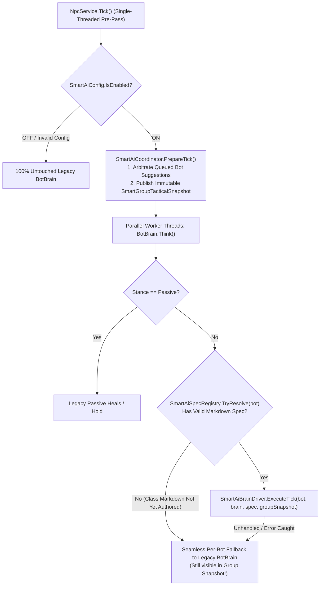
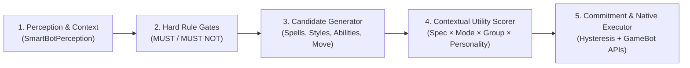
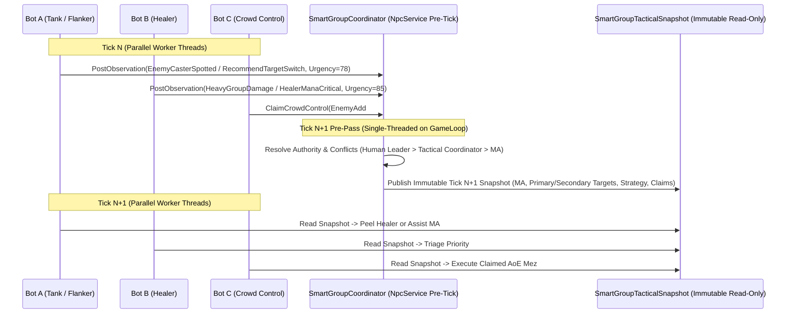

# Document 2: SmartAI Technical Architecture (`SMARTAI_ARCHITECTURE.md`)

> [!IMPORTANT]
> **Epistemic Discipline:** Throughout this specification, **Verified Project Facts**, **External Research Findings**, **Architectural Recommendations**, and **Assumptions Requiring Confirmation** are explicitly distinguished so Claude Code can implement against verified server contracts without guesswork.

---

## 1. External AI Pattern Research & Tradeoff Comparison

### 1.1 Evaluation Against OfflineDAoC True 1.65 Constraints
- **Verified Server Constraints**:
  - **30 TPS ECS GameLoop (`33.33 ms` tick budget)** ([GameLoop.cs](file:///C:/OfflineDAoC-True165-MP/OfflineDAoC-True165-MP/development-source/server/GameServer/Managers/GameLoop/GameLoop.cs#L27-L43)), with `NpcService.Tick()` executing hundreds of `ABrain.Think()` pulses in parallel across CPU cores ([NpcService.cs](file:///C:/OfflineDAoC-True165-MP/OfflineDAoC-True165-MP/development-source/server/GameServer/ECS-Services/NpcService.cs#L25-L50)).
  - **39 True 1.65 classes × 3 specializations = 117 distinct tactical profiles**, authored incrementally in human-editable Markdown files across **3 game modes (`PvE`, `PvP`, `RvR`)** and **6 personality profiles**.
  - **Strict Local Determinism**: Zero external LLM/cloud calls, zero heavy per-tick heap allocations, and instant fallback to legacy `BotBrain`.

- **External Research Comparison** (Established Game AI literature: Dave Mark *Behavioral Mathematics for Game AI* / Infinite Axis Utility Systems; Isla & Champandard Behavior Trees; Orkin *FEAR* GOAP; Humphreys/GDC HTN planners):

| Architecture Pattern | Strengths | Weaknesses in OfflineDAoC True 1.65 | Verdict |
|---|---|---|---|
| **Pure Finite-State Machine (FSM)** *(Current `BotBrain`)* | Fast, simple state transitions (`IDLE`, `FOLLOW`, `AGGRO`, `PASSIVE`). | State/transition explosion across 117 specs × 3 modes; rigid `if/else` cascades cannot smoothly weigh competing tactical priorities (e.g., emergency peel vs. interrupt vs. DPS assist). | **Keep outer `BotBrain` 4-state lifecycle**, replace inner combat `if/else` when SmartAI is active. |
| **Pure Behavior Trees (BT)** | Good hierarchical readability; popular in single-player Unreal/Unity NPCs. | Expressing 117 Markdown-driven class profiles + 6 continuous personality modifiers + 3 mode overlays in pure BTs creates deep tree duplication and rigid priority ordering where a 2% score shift cannot override branch order. | **Do not use deep tree traversal**; borrow **hard sequence/decorator guards** as top-level Rule Gates. |
| **GOAP / HTN Planners** | Emergent multi-step planning via forward/backward state-space search. | State-space search + world-state cloning across 300+ concurrent bots on a 33ms C# server tick creates GC pressure and unpredictable latency spikes (`AiTurnStallMonitor`), while DAoC combat is a reactive 1.5s–4.0s swing/cast loop rather than a puzzle planner. | **Reject** (unnecessary CPU/GC complexity). |
| **Rule-Gated Tactical Utility Engine + Group Blackboard** *(Hybrid Engine)* | Hard boolean **Rule Gates** (`MUST` / `MUST NOT` invariants, mez-respect, cooldown/LOS/power gates) guarantee DAoC mechanical correctness, while normalized **Contextual Utility Scoring** (`[0.0 .. 100.0]`) cleanly composes Markdown Spec Priorities × Game Mode Deltas × Group Blackboard Signals × Personality Multipliers in $O(Candidates)$ stack-allocated math (`< 0.05 ms`/bot). | Requires explicit score hysteresis / commitment locks to prevent target or action oscillation. | **Selected Architecture** (best match for C#/.NET 10 ECS server, Markdown data-driven specs, and 6 personalities). |

---

## 2. High-Level Integration & Dual-Layer Legacy Fallback

### 2.1 Zero-Disruption Integration Seam
**Verified Project Fact:** Every bot combat turn passes through [`BotBrain`](file:///C:/OfflineDAoC-True165-MP/OfflineDAoC-True165-MP/development-source/server/GameServer/bots/BotBrain.cs#L3225-L3285) (`BotState_Aggro.Think()`, `BotState_Follow.Think()`, `BotState_Idle.Think()`), even for Autonomous World Bots ([`AutonomousWorldBotController.Tick`](file:///C:/OfflineDAoC-True165-MP/OfflineDAoC-True165-MP/development-source/server/GameServer/bots/autonomous/AutonomousWorldBotController.cs#L421-L448)).

**Architectural Recommendation:** Place all new SmartAI code in an isolated namespace and folder: `development-source/server/GameServer/smartai/` (`namespace DOL.GS.SmartAI`). Touch existing files at **only 5 surgical hook points**:

### 2.2 Two-Tier Fallback Guarantees (Requirement 2.D & 4)
1. **Global Toggle Fallback (`Use SmartAI = OFF` or Fatal Config Error)**:
   - `SmartAiConfig.IsEnabled` evaluates to `false`.
   - `SmartAiCoordinator.PrepareTick()` and `SmartAiBrainDriver.TryThinkCombat()` return `false` in a single predicted branch (`if (!SmartAiConfig.IsEnabled) return false;`). Zero SmartAI allocations, timers, or decisions run; Hired Companions and Autonomous Bots behave 100% identically to current v0.2.
2. **Per-Bot Incremental Class Fallback (`Use SmartAI = ON`, Class Markdown Not Yet Provided)**:
   - Because the user will author the 39 True 1.65 classes incrementally, a mixed group (e.g., a SmartAI-defined **Cleric** and **Armsman** grouped with an not-yet-defined **Theurgist**) **must work seamlessly together**.
   - `SmartGroupTacticalSnapshot` inspects **all** `Group` members (`GamePlayer` and `GameBot` alike), so SmartAI bots see legacy bots' HP/power/aggro/targets, while any bot whose class Markdown file does not yet exist (or fails schema validation) returns `false` from `SmartAiBrainDriver.TryThinkCombat` and executes existing `BotBrain` combat without error.
   - Any exception inside `SmartAiBrainDriver` is caught, rate-limit logged via `SmartAiDiagnostics`, trips a short per-bot circuit breaker (`10s`), and falls back to legacy `BotBrain` for that tick so a bad rule never stalls `GameLoop`.

---

## 3. Hybrid Decision Engine (`DOL.GS.SmartAI.Decision`)

### 3.1 Five-Stage Decision Pipeline
On each `BotBrain` think pulse (`500 ms` in combat; event-nudged down to `200 ms` on urgent interrupt/emergency-heal triggers via `brain.NextThinkTick = Math.Min(...)`), `SmartAiBrainDriver` runs five deterministic stages using stack-allocated `struct` contexts:

1. **Stage 1 — Situation & Perception Builder (`SmartBotPerception`)**:
   - Builds a `readonly ref struct` snapshot of:
     - **Self state**: HP%, Mana%, Endurance%, Concentration%, `IsCasting`, `IsBeingInterrupted` (`InterruptRemainingDuration`), active weapon slot, stealth state, active effects (`Disease`, `Poison`, `Nearsight`, `Root`, `Snare`), available cooldowns.
     - **Game Mode (`SmartGameMode`)**: Resolved deterministically without string allocations:
       - `RvR`: `bot.CurrentRegion.IsRvR` or frontier keep/battleground zone (`AutonomousRvrDirector` / `KeepMgr` / enemy realm players/bots >= RvR skirmish threshold or keep/relic context).
       - `PvP`: Any hostile target in aggro/group-engagement set satisfies `PlayerRules165.IsPlayerLike(enemy)` (`GamePlayer` or enemy-realm `GameBot`, or pet owned by one) outside large-scale RvR keep/warband context.
       - `PvE`: All hostile targets are non-player-like `GameNPC` monsters.
     - **Resolved Specialization (`SmartResolvedSpec`)**: Cached `(ClassId, SpecId, SpecVersion)` re-evaluated only on spawn, level-up, `CompanionTrain`, `CompanionRespec`, or `/smartai reload`.
     - **Group Tactical Snapshot (`SmartGroupTacticalSnapshot`)**: Read lock-free from the group's current tick snapshot.

2. **Stage 2 — Hard Rule Gates (`SmartRuleGateEvaluator`)**:
   - Enforces non-negotiable DAoC 1.65 & player-command invariants **before** utility scoring:
     - **Player Owner Authority**: Never violate Hired Companion `Stance == Passive`, `Stay/Wait` anchor, `CompanionEngagementMode.Defend` (do not initiate unprovoked pulls), or explicit `/say` / `/g` owner target/stop orders.
     - **Active Cast & Swing Preservation**: Mirror `BotBrain.cs:4183`—if `bot.IsCasting || bot.castingComponent.HasPendingSkillRequests` (or Necromancer shade `HasPendingBotCommand`), **hold current cast** unless an emergency abort rule triggers (e.g., heal target reached `>95%` HP or CC target is already mezzed by an ally!).
     - **Mez & Breakable-Root Respect**: Never select single-target damage, DoT, pet-attack, or AoE that clips a `IsMezzed` or `IsBreakablyControlled` enemy (`BotBrain.CrowdControlRespect`) unless that enemy is the **sole remaining hostile** or explicitly called by a human Main Assist.
     - **MUST NOT Prohibitions**: Evaluates declarative `must_not` rules from the specialization's Markdown definition (e.g., *"MUST NOT cast non-instant spells while interrupted unless QuickCast or Mastery of Concentration is active"*, *"MUST NOT use PBAoE when <2 valid un-mezzed enemies are within radius"*, *"MUST NOT overwrite a higher-value Snare/Mez/Debuff or trigger target CC immunity"*).
     - **MUST Mandatory Overrides**: Evaluates high-priority survival/role triggers (e.g., `Purge` when stunned/mezzed under focus fire in RvR/PvP; primary healer emergency instant heal when group member `< 30%` HP).

3. **Stage 3 — Candidate Action Generator (`SmartCandidateGenerator`)**:
   - Populates a bounded stack buffer (`Span<SmartActionCandidate>`, max 24 candidates) across 7 action families:
     1. `EmergencySelfOrGroupSurvival` (Instant heals, `IgnorePain`, `BoF`, `SoldiersBarricade`, `Purge`, `QuickCast` + Heal/Mez, potions).
     2. `TriageHealAndCure` (`HealBig`, `HealEfficient`, `HealSpread`, `HealGroup`, `CureMezz`, `CureDisease`, `CurePoison`—explicitly handling `HealBig ?? HealEfficient` and scanning `GetAllUsableListSpells(true)` when ListCaster rank-collapse hides fast heals).
     3. `CrowdControl` (AoE Mez, Single Mez, Stun, Root, Snare, Nearsight, Amnesia—filtered against target immunity effects and `SmartGroupTacticalState` CC claims).
     4. `Interrupt` (Instant DD/Stun/Amnesia, ranged shot, pet interrupt on casting enemy healers/CCers).
     5. `DefensiveSupportAndPeel` (`Guard` MA/healer, `Protect` healer, `Intercept` squishy, `Engage` ranged attacker, taunt/stun peel off healer).
     6. `PrimaryOffense` (MA-assisted nuke/bolt/debuff/DoT, melee attack + **positional/chain/reactive/stealth `Style` selection**, archery `Critical`/`RapidFire`/`SureShot`, pet commands, offensive abilities like `Berserk`, `Flurry`, `DirtyTricks`, `TripleWield`).
     7. `TacticalPositioning` (Caster/archer range-keeping & kiting, flanker/assassin rear `150°–210°` or side `45°–150° / 210°–315°` arc positioning when target's `TargetObject != bot`, LOS recovery).

4. **Stage 4 — Contextual Tactical Utility Scorer (`SmartUtilityScorer`)**:
   Each valid candidate $a$ on target $t$ receives a deterministic composite score:
   $$\text{Score}(a, t) = \left( B_{\text{spec}}(a) + \Delta_{\text{mode}}(a) + C_{\text{context}}(a, t) + G_{\text{group}}(a, t) \right) \times M_{\text{personality}}(a) \times R_{\text{resource}}(a) + H_{\text{stickiness}}(a, t)$$
   - $B_{\text{spec}}(a)$: Base priority weight `[0..100]` compiled from the Markdown specialization's `offensive_priorities`, `defensive_priorities`, and `ability_priorities`.
   - $\Delta_{\text{mode}}(a)$: Game-mode (`RvR`, `PvP`, `PvE`) additive/multiplicative adjustment from Markdown.
   - $C_{\text{context}}(a, t)$: Live tactical urgency (e.g., target HP deficit, enemy cast progress & spell danger tier, target resistance debuff match, positional opening availability, CC cluster count).
   - $G_{\text{group}}(a, t)$: Bonus for matching `MainAssistTarget` (`+25`), assigned CC/interrupt claim (`+35`), or peeling an enemy hitting the group's primary healer (`+30`); heavy penalty (`-80`) if another bot already claimed the same single-target heal/CC/interrupt.
   - $M_{\text{personality}}(a)$: Bounded personality multiplier `[0.80 .. 1.25]` (Section 5).
   - $R_{\text{resource}}(a)$: Mana/Endurance conservation curve from Markdown `resource_management` (penalizes inefficient nukes/styles below reserve floor while keeping heals/interrupts unpenalized).
   - $H_{\text{stickiness}}(a, t)$: Anti-oscillation commitment bonus (`+15` for current target within stickiness window).

5. **Stage 5 — Native Action Execution (`SmartActionExecutor`)**:
   - Executes strictly through verified True 1.65 player-rules APIs:
     - **Spells**: `bot.CastSpell(spell, line, checkLos: true)`. For `QuickCast`, activates `new QuickCastECSGameEffect(...)` and passes through a SmartAI-safe overload `bot.CastSpell(spell, line, allowQuickCast: true)` (preserving legacy `CastSpell` behavior when `allowQuickCast == false`).
     - **Melee Styles (Unlocking Positionals & Stealth Openers)**: Adds `SmartStyleSelector` alongside `BotMeleeStylePolicy` (only active when SmartAI drives the bot) so `StylesBack`, `StylesSide`, `StylesFront`, and `StealthRequirement` styles are eligible when `StyleProcessor.CanUseStyle` & bot relative angle match! Sets `bot.styleComponent.NextCombatStyle` and `NextCombatBackupStyle`.
     - **Class & Realm Abilities**: Constructs verified ECS ability effects (`BerserkECSGameEffect`, `StagECSGameEffect`, `EngageECSGameEffect`, `GuardECSGameEffect`, `ProtectECSGameEffect`, `InterceptECSGameEffect`, `DirtyTricksECSGameEffect`, `RapidFireECSGameEffect`, `SureShotECSGameEffect`) or invokes `TimedRealmAbility.Execute(bot)` for **both** Autonomous Bots and Hired Companions (reading companion RAs trained via `CompanionWindows165`!).

---

## 4. Bot-to-Bot Communication Architecture (Requirement 2.B)

### 4.1 Complementary Two-Tier Communication Model
Instead of CPU-heavy string parsing or chat spam, SmartAI uses **in-memory structured C# records** coordinated once per tick in `NpcService.Tick()`, with optional rate-limited immersive `/g` callouts for human players:

### 4.2 System 1: Shared Tactical State (`SmartGroupTacticalState` & `SmartGroupTacticalSnapshot`)
Stored per `Group` in `ConditionalWeakTable<Group, SmartGroupTacticalState>` (automatically GC'd if a group disbands, plus cleaned on `GroupEvent.MemberDisbanded`). Every tick in `SmartAiCoordinator.PrepareTick()`, each active group publishes an immutable `SmartGroupTacticalSnapshot` containing all 11 required tactical dimensions:
1. **`MainAssist` & `PrimaryTarget`**: Elected MA (`GameLiving`) + current `PrimaryTarget` + `PrimaryTargetLockUntilTick`.
2. **`SecondaryTargets`**: Up to 3 ranked kill-queue targets (`Target`, `Reason`, `PriorityScore`).
3. **`EnemyPriorities`**: Per-hostile threat classification (`EnemyHealer`, `EnemyCrowdController`, `EnemyCasterDps`, `EnemyStealtherOnBackline`, `BossOrNamed`, `StandardAdd`) + debuff/vulnerability flags + CC immunity timers.
4. **`GroupEngagementStatus`**: `Disengaged`, `Pulling`, `Skirmishing`, `Committed`, `PeelingBackline`, `Retreating`, `Recovering`.
5. **`CrowdControlAssignments`**: Thread-safe claim table (`TargetObjectID -> ClaimingBotId, CcType, ExpiresTick`) preventing double-mezzing or breaking claimed targets.
6. **`InterruptAssignments`**: Staggered rotation assignments (`EnemyCasterId -> PrimaryInterrupterBotId, BackupInterrupterBotId, CastEndTick`).
7. **`HealingPriorities`**: Ranked injured roster (`Member`, `EffectiveHealthDeficit`, `IncomingAttackerCount`, `ClaimedByHealerBotId`, `ClaimedHealAmount`) + Disease/Mez cure claims.
8. **`DefensiveCooldownStatus`**: Active & available group defensive RAs/abilities (`BoF`, `AoF`, `SoldiersBarricade`, `GroupPurge`/`AmelioratingMelodies`, `Guard`/`Protect`/`Intercept` pairings) so two tanks never blow `BoF` + `SoldiersBarricade` on the exact same tick!
9. **`GroupPositioning`**: `AnchorPoint` (`Vector3`), `FrontlineLine`, `BacklineSafeSpot` (`1000–1300u` behind frontline with LOS), and `RetreatRallyPoint`.
10. **`RetreatAndEngagementDecision`**: Hysteresis-protected `EngagementDirective` (`Hold`, `Engage`, `PushAdvantage`, `KiteBack`, `FullRetreat`) with numeric `ConfidenceScore` and `LockedUntilTick`.
11. **`CurrentGroupStrategy`**: `StandardAssistTrain`, `BurnPriorityCaster`, `ProtectBackline`, `ParkAddsAndSingleTarget`, `AoeBombardment`, `ConserveManaGrind`, or `EmergencyTriage`.

### 4.3 System 2: Individual Bot Communication (`SmartBotObservation`)
During parallel `Think()`, any bot can enqueue up to 2 lightweight `readonly record struct SmartBotObservation` messages into the group's lock-free/spin-locked ring buffer (`Capacity = 32`):
- **Typed `SmartObservationKind` Enum**:
  - `RecommendTargetSwitch` (e.g., Tank spots unguarded enemy Cleric/Pac Healer or interrupted cloth caster)
  - `TargetVulnerable` (e.g., DPS/Debuffer lands resist debuff, stun, PA/CD bleed, or sees `<25%` HP without `IgnorePain`)
  - `HeavyGroupDamageWarning` (e.g., Healer detects group DPS intake exceeding heal throughput)
  - `HealerUnderAttack` / `HealerLowMana` (e.g., Healer has 2+ melee attackers or `<20%` power)
  - `CrowdControlOpportunity` (e.g., Sorcerer/Bard/Pac Healer sees 3+ un-mezzed enemies clustered within AoE radius)
  - `EnemyDangerousCast` (e.g., Enemy casting Rez, AoE Mez, or PBAoE)
  - `RecommendRetreat` / `RecommendPressAdvantage` (e.g., Scout/Leader evaluates force ratio & casualties)
- **Optional Player-Facing Callouts (`SmartGroupCalloutPolicy`)**: Only when a **human `GamePlayer`** is in the group, top-priority accepted suggestions (max 1 message every `8 seconds` per group, never spamming) can optionally emit a concise `/g` callout via existing `CompanionChat165` / `Group.SendMessageToGroupMembers` (e.g., *"[Group] Cedric: Switching to Midgard Healer — interrupt heals!"* or *"[Group] Eluned: Heavy damage & 28% mana, play defensive!"*).

### 4.4 Authority Hierarchy & Conflict Resolution
When bots post conflicting suggestions in the same tick (e.g., an `Aggressive` Berserker posts `TargetVulnerable` to push deep while a `Supportive` Healer posts `HeavyGroupDamageWarning` + `HealerUnderAttack` to peel/retreat), `SmartGroupCoordinator.Arbitrate()` resolves them deterministically on a single thread:

1. **Tier 0 — Human Player Absolute Veto & Command Authority**:
   - If a human `GamePlayer` is `Group.Leader` (or Hired Companion `Owner`), explicit player commands (`passive`, `stay`, `come`, `attack`, `assist`, `/companionui`) **always win**. If the player is set as Main Assist (default in Companion `Assist` mode), bots assist the player's target unless peeling a lethal threat off the player/healer.
2. **Tier 1 — Group Survival & Wipe-Prevention Veto**:
   - `RecommendRetreat` (when outnumbered & group EHP `< 35%` with dead/OOM healer, *except* in player-led groups where companions **never abandon a fighting human owner**—instead shifting to `EmergencyTriage` + `ProtectBackline` and warning the player!) overrides offensive push suggestions.
   - `HealerUnderAttack` + `HeavyGroupDamageWarning` (`Urgency >= 80`) shifts `CurrentGroupStrategy` to `ProtectBackline`, assigning off-tank/peeler CC/taunt to the healer's attacker while keeping the MA + primary DPS on a `<15%` HP dying target if finishable within 1 swing/cast.
3. **Tier 2 — Tactical Group Leader & Main Assist Authority**:
   - Every group elects a `TacticalLeader` (Human Leader if present, else highest-level Tank/Hybrid/Bard/Healer bot) and a `MainAssist` (`MA`: best melee/hybrid/archer target-caller). *(Never calls `Group.MakeLeader(bot)` due to the verified `Group.cs:461` `NullReferenceException` bug).*
   - Conflicting `RecommendTargetSwitch` vs. `TargetVulnerable` proposals are scored by `Urgency × ProposerRoleWeight` minus a **Target Switch Hysteresis Penalty (`+20` minimum improvement required, plus `3.5s` minimum target hold unless current target died, entered Mez/Immunity, popped `IgnorePain`/`BoF`, or ran out of range/LOS)**.

---

## 5. Personality System (Requirement 2.C)

### 5.1 Six Configurable Profiles + Spec Default (`Auto`)
Personalities apply **bounded utility multipliers (`0.80x` to `1.25x`) and threshold offsets** inside `SmartUtilityScorer`—they **never bypass Stage 2 Hard Rule Gates** (a `Aggressive` Cleric will still heal a `<50%` tank before smiting, and an `Opportunistic` Mercenary will still never break mez!).

| Profile | Off. Weight | Def./Self-Preservation | Target Preference | Positioning Offset | Cooldown / Mana Spend |
|---|---|---|---|---|---|
| **`Aggressive`** | `1.20x` | `0.85x` (delays self-kiting until lower HP) | High-value casters/healers, pushes advantage early | Closer melee/cast envelope; aggressive flank pursuit | Early offensive cooldowns (`Berserk`, `Flurry`); lower mana reserve (`15%`) |
| **`Defensive`** | `0.85x` | `1.25x` | Attackers threatening healer/owner (`Peel` `+30%`) | Tight leash to group anchor/healer; shield/parry bias | Saves defensive RAs for spikes; higher mana reserve (`30%`) |
| **`Tactical`** | `1.05x` | `1.05x` | High debuff/interrupt/CC value & strict MA sync (`+20%`) | Optimal LOS, arc, and max-effective-range discipline | Balanced cooldown rotation; `20%` mana reserve |
| **`Opportunistic`** | `1.15x` | `0.95x` | Vulnerable (`<35%` HP, stunned, debuffed, isolated) targets (`+25%`) | Active rear/side positional flanking & stealth openers | Saves burst for vulnerable windows; `20%` mana reserve |
| **`Supportive`** | `0.80x` | `1.20x` (ally triage/cures/peels `+25%`) | Interrupting threats to allies; debuffing MA target | Positioned for full-group heal/cure LOS coverage | Prioritizes mana for heals/cures/rez (`35%` offensive floor) |
| **`Conservative`** | `0.90x` | `1.15x` | Safe closest/pulled front target; avoids over-extension | Max safe cast/bow range; early retreat recommendation | Strict endurance/mana rationing (`35%` reserve); holds long RAs for emergencies |

### 5.2 Non-Disruptive Persistence & Configuration
- **Database Side-Table (`[DataTable(TableName = "offline_bot_smartai_profiles")]`)**:
  - Follows the exact `HiredCompanions165` side-table pattern ([`HiredCompanions165.cs:15–33`](file:///C:/OfflineDAoC-True165-MP/OfflineDAoC-True165-MP/development-source/server/GameServer/mode165/HiredCompanions165.cs#L15-L33)) so `offline_world_bots` schema is never altered:
    - `[PrimaryKey] public long BotId { get; set; }`
    - `[DataElement(AllowDbNull = false)] public string Personality { get; set; }` (`"Auto"` default -> uses specialization's Markdown `default_personality`, or one of the 6 profile names)
    - `[DataElement(AllowDbNull = false)] public string PreferredRole { get; set; }` (`"Auto"`, `"MainAssist"`, `"Tank"`, `"Healer"`, `"CrowdControl"`, `"Damage"`)
    - `[DataElement(AllowDbNull = false)] public string UpdatedUtc { get; set; }`
  - Auto-registered by `GameServer.InitDB()` (`GameServer.cs:1208–1215`) and cached in memory (`ConcurrentDictionary<long, OfflineBotSmartAiProfileRecord>`) at `[GameServerStartedEvent]`, with async queued writes off the game loop.
  - Added to `ProgressTables` in `runtime/true165/progress-policy.json` (and mirrored in `tools/claude-version/true165/progress-policy.json`) when user approves content-policy sync so database refreshes keep player personality customizations.
- **Configuration UX**:
  - **Hired Companions & Player-Led Bots**: Configurable in-game via player command `/smartai personality <botName|target> <auto|aggressive|defensive|tactical|opportunistic|supportive|conservative>` and natural `/say` / `/g` companion chat hooks in `CompanionChat165` (e.g., `"Cedric personality defensive"`).
  - **Autonomous World Bots**: Deterministic SplitMix64 hash of `BotId` (`60%` spec default `Auto`, `40%` compatible personality variation) unless explicitly overridden in `offline_bot_smartai_profiles`, making enemy and allied world bots feel organically varied!

---

## 6. Game Mode Intelligence (`RvR`, `PvP`, `PvE`) Without Duplication (Requirement 5)

To prevent triplicating class definitions across modes, SmartAI uses **Layered Mode Inheritance**: each specialization defines one **Shared Class/Spec Base** (core abilities, chains, resource rules, role, `should`/`must_not`) plus compact **Mode Overlays (`pve`, `pvp`, `rvr`)** that override only target weights, CC posture, positioning, and cooldown aggressiveness:

1. **RvR Mode (Large-Scale Frontier, Keeps, Relic Raids, Battlegrounds)**:
   - **Group & Battlegroup Coordination**: Integrates with `AutonomousRvrDirector` and `RealmWarbandSupport` (`WarbandAnchor`) without altering strategic objective routing. Within warbands, multiple 8-man groups coordinate via a region-scoped `SmartBattlegroupState` (`KeepLordPush`, `BreachDefense`, `BridgeChoke`, `OpenFieldTrain`) so 3 groups don't waste 3 AoE Mezzes on the same front tank!
   - **Target Prioritization**: `EnemyPacOrBardOrSorc (Uncrowdcontrolled)` / `EnemyClericDruidHealer` -> `Interrupted Cloth Caster` -> `Overextended Melee on Backline` -> `Tanks` last.
   - **CC, Assist & Realm Tactics**: High priority on long-range AoE Mez, Nearsight on enemy healers/casters, Disease on assist targets (halving enemy healing!), tight melee/caster assist bursts on `MainAssistTarget`, keep-door/oil/wall LOS awareness, and realm-aware counters (e.g., respecting Midgard `Pac` instant mez/stun range, Hibernia `PBAoE` bomb stacks + `Stag`, Albion `Sorcerer`/`Theurgist` pet-interrupt swarms).
2. **PvP Mode (Solo & Small-Group 1v1–8v8 Skirmishes)**:
   - **Solo & Small-Man Adaptivity**: Tracks enemy active buffs/RAs (`IgnorePain`, `BoF`, `SoldiersBarricade`, `MoC`, `Berserk`, `Engage`, `QuickCast`) and CC immunity timers (`mez_immunity`, `stun_immunity`).
   - **Interrupts, Kiting & Positioning**: Casters/archers snare/root melee pursuers and kite to max cast range before hard-casting; melee DPS switches to side/rear positional styles on stunned/engaged enemies or uses `Engage` against archers when unable to close; stealthers (`Infiltrator`, `Shadowblade`, `Nightshade`, `Scout`, `Hunter`, `Ranger`) execute stealth openers (`Perforate Artery` / `Creeping Death`) on isolated cloth/leather targets.
3. **PvE Mode (Solo, Companion 8-Man, Autonomous Camps & Dungeons)**:
   - **Aggro, Tanking & Pulling**: Respects `PlayerLedPullCoordinator` and `AutonomousGroupCombatDoctrine`. Dedicated tank holds aggro with `StylesTaunt` + peel stuns; off-tanks/DPS hold burst for `1.5s` on fresh pulls or maneuver to monster rear/side arcs (unlocking positional style chains safely in PvE!).
   - **Mob Targeting, BAF Adds & Resource Economy**: Parks BAF adds with Mez/Root (`ParkAddsAndSingleTarget`), focuses lowest-HP un-held mob on MA, conserves mana (`ConserveManaGrind`, avoiding overkill big nukes on `<12%` HP mobs), and shifts to boss/encounter survival posture against high-level (`orange`/`red`/`purple`) named mobs.

---

## 7. Group Intelligence & Strategy (Requirement 6)

`SmartGroupCoordinator` turns any 2–8 member group (and `IsCompanionRaid` 40/80 groups via sub-squads of 8) into a coordinated DAoC team:
- **Dynamic Role Assignment (`SmartRoleResolver`)**: Inspects live group composition on join/leave/respec/incapacitation. If the primary `Rejuv Cleric` dies or is mezzed, a hybrid (`Friar`, `Paladin`, `Warden`, `Shaman`, `Bard`, `Mentalist`) is **dynamically promoted to `EmergencyPrimaryHealer`** for the duration of the incapacitation!
- **Main Assist (`MA`) Election**: Human player (if Companion `Assist` mode), else highest-spec pure melee/hybrid (`Armsman`, `Mercenary`, `Berserker`, `Savage`, `Warrior`, `Hero`, `Blademaster`, `Champion`), else primary ranged DPS. If the MA is mezzed/stunned/dead, `BackupMainAssist` seamlessly assumes target-calling until the MA recovers.
- **Healing, CC & Interrupt Rotations**:
  - **Heals**: Primary healer takes `HealBig`/`HealEfficient` on heavy deficits; secondary healer covers `HealSpread`/spot-heals and cures (`CureMezz` -> `CureDisease` -> `CurePoison` via `BotCurePrioritizer`).
  - **Interrupts**: Assigns `Interrupter #1` (cheapest fast/instant/pet interrupt: Theurgist pet, Mentalist/Bard/Thane/Sorc instant, Archer shot) to enemy Healer #1 and `Interrupter #2` to enemy Caster/Healer #2 so all interrupts aren't blown on the same target.
  - **Casualty & Missing-Member Awareness**: Tracks dead, mezzed, linkdead/out-of-range (`> 2500u`), or resting members; suppresses aggressive forward pulls when healers are `< 35%` mana or key members are dead/incapacitated, prioritizing safe In-Combat Rez (`Reanimate`) when incoming DPS permits.

---

## 8. Performance, Concurrency & Anti-Oscillation Safeguards (Requirement 7)

| Concern | Concrete Engineering Safeguard |
|---|---|
| **CPU & Tick Budget (`33.33 ms`)** | Pre-tick group snapshot runs once per active group in `NpcService.Tick()` (`O(Groups)`). Per-bot utility evaluation uses flat arrays/`Span<SmartActionCandidate>` (`<= 24` items) with zero reflection, zero LINQ, and zero regex in combat (`< 0.05 ms` avg per bot). |
| **Memory & GC Overhead** | Immutable class/spec templates parsed **once at server startup** into frozen arrays (`FrozenDictionary`). Per-tick candidate buffers live on the stack (`stackalloc` / `struct`); group snapshots reuse pooled double-buffered arrays per `SmartGroupTacticalState` (zero Gen0 heap churn per tick). |
| **Thread Safety** | `SmartAiCoordinator.PrepareTick()` mutates `SmartGroupTacticalSnapshot` on the single `"GameLoop"` thread before `ExecuteForEach`. Intra-tick CC/interrupt/heal claims use lightweight per-group `System.Threading.Lock` inside `SmartGroupTacticalState` (never locking across two groups and never calling `Group` mutators under lock). |
| **Anti-Target-Thrashing (Hysteresis)** | `PrimaryTargetLockUntilTick` (`3500 ms` min hold) + `+15` current-target stickiness bonus + `+20` minimum score delta to switch targets mid-fight (bypassed immediately if target dies, becomes mezzed, pops `IgnorePain`, or breaks range/LOS). |
| **Anti-Command-Loop & Ability Spam** | Action commitment window (`1000 ms` move/kiting hysteresis so bots don't jitter back and forth at range edge; per-ability reuse gate + target effect existence check before casting buffs/debuffs/DoTs; cast-in-progress lock). |
| **Logging & Telemetry** | Combat trace logging is **OFF by default**, gated behind `SmartAiDiagnostics.IsTraceEnabled(botId)` (per-bot ring buffer of last 32 decisions inspectable via `/smartai debug <bot>` without disk I/O spam). Integrates directly with existing `BotAiDelayReport` and `AiTurnStallMonitor`. |

---

## 9. Assumptions Requiring Owner Confirmation

1. **Hired Companion Retreat Behavior**: We recommend that Autonomous bot groups can execute `FullRetreat` when heavily outnumbered, whereas **Hired Companions never flee and abandon a live fighting human owner**—instead shifting to `ProtectBackline` / `EmergencyTriage` and warning the owner unless the owner runs away or calls `follow`/`passive`. Confirm if you also want an explicit `"retreat"` companion voice command.
2. **Optional `/g` Tactical Callouts**: We recommend rate-limiting human-visible `/g` tactical callouts from SmartAI companions to at most **1 concise message per 8 seconds** (and zero chat packets for distant all-bot groups), with a ServerProperty (`smart_ai_group_callouts = true`) to mute them if desired.
3. **Positional Flanking Movement in Player-Led Groups**: When a Hired Companion is a positional melee DPS (`Infiltrator`, `Mercenary`, `Shadowblade`, `Berserker`, `Nightshade`, `Blademaster`, etc.) and **does not hold aggro**, we recommend allowing SmartAI to micro-step (`~65–110` units) to the target's side/back arc to land positional style chains, disabled automatically near dungeon ledges or when `Stay` is ordered.
